

<b>You are a drop of water. The mountain is real. First one to the valley wins.</b> A 3D couch race in the browser: the TV shows the race, your phone is the controller.

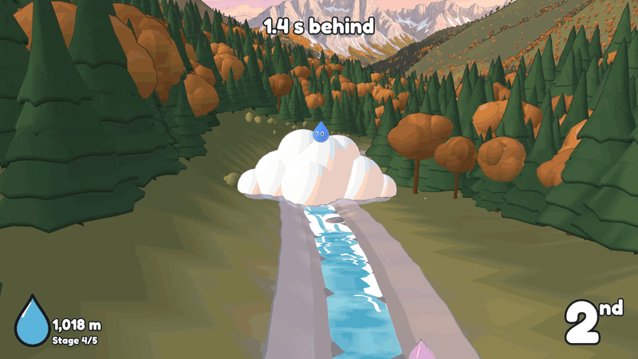

## How it works

| | Where | What happens |
|---|---|---|
| 1 | **TV** | `npm run play` on the computer plugged into the TV. It shows a QR code |
| 2 | **QR** | Each phone scans it. No app, no account, two players on the same Wi-Fi. Swipe through the mountains and vote |
| 3 | **Phones** | Hold it sideways: one thumb steers, the other presses BOOST. The race stays on the TV |

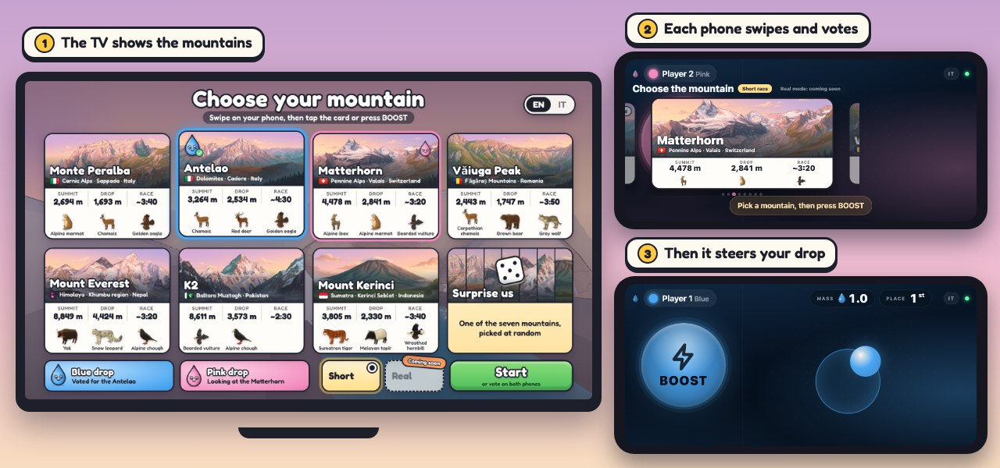

## Seven real mountains

Every course runs from the summit down to a real place in the valley, and the ground is real elevation data at 1:1. The distant views are paintings made from real photos of those places.

<table>
<tr>
<td width="50%">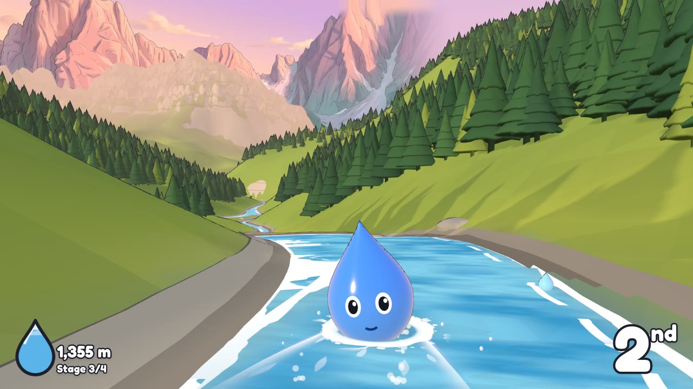 <b>Monte Peralba</b> Carnic Alps, Italy. Down Val Sesis to the Acquatona Gorge</td>
<td width="50%">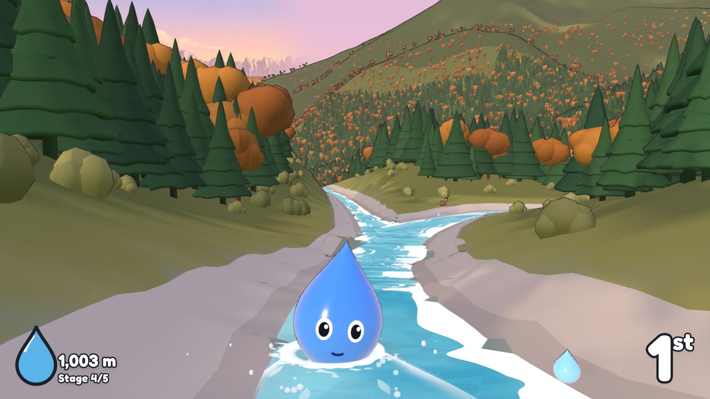 <b>Antelao</b> Dolomites, Italy. From the glacier down Val d'Oten to Calalzo</td>
</tr>
<tr>
<td width="50%">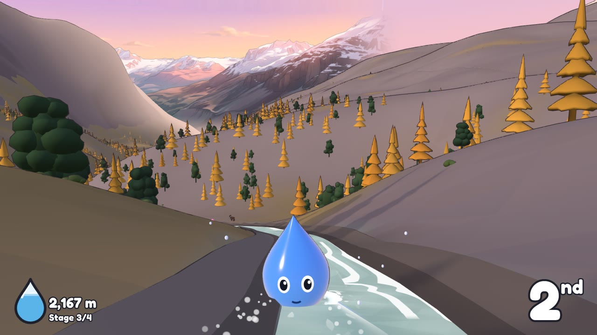 <b>Matterhorn</b> Pennine Alps, Switzerland. Down the north face and the Zmutt valley to Zermatt</td>
<td width="50%">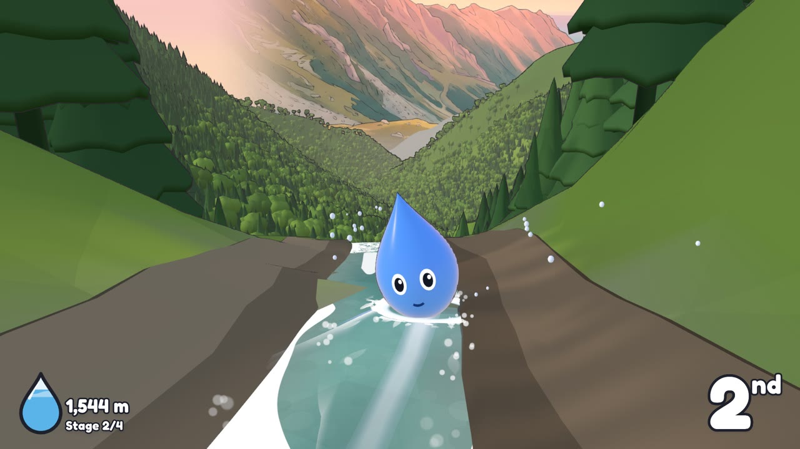 <b>Văiuga Peak</b> Făgăraș Mountains, Romania. Past Lake Bâlea and its waterfall to the beech woods</td>
</tr>
<tr>
<td width="50%">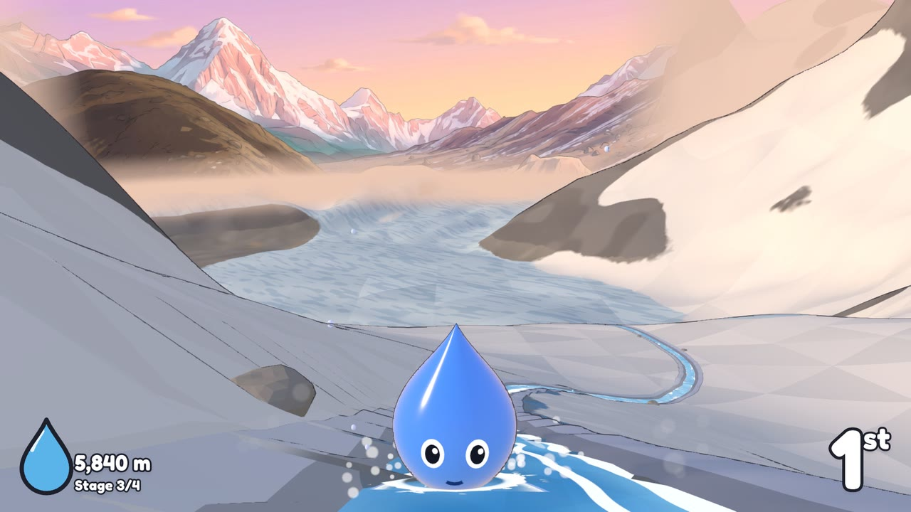 <b>Mount Everest</b> Khumbu, Nepal. The Western Cwm and the Khumbu Icefall, down to Thukla</td>
<td width="50%">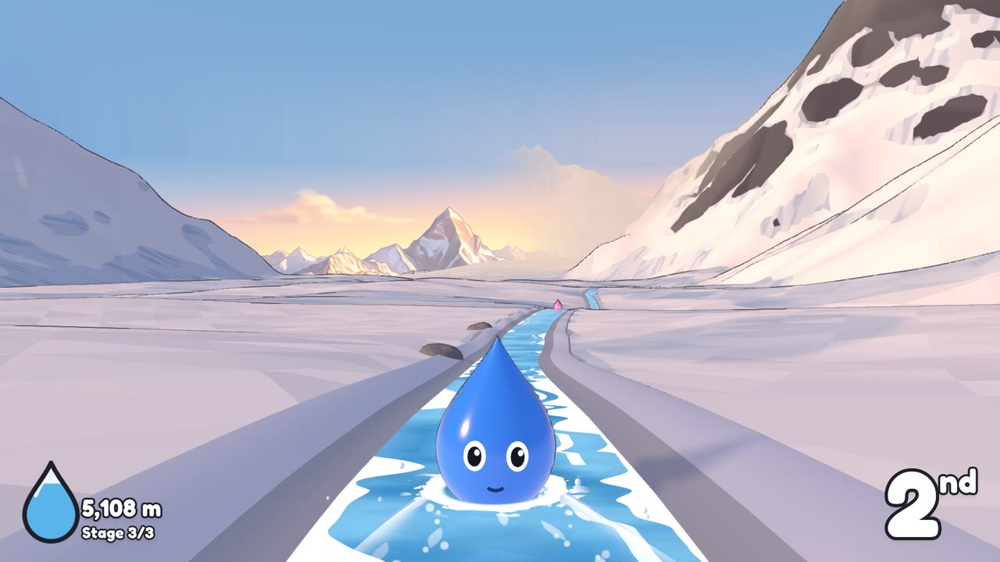 <b>K2</b> Baltoro Muztagh, Pakistan. The Bottleneck, the Shoulder and the south-east face, down to the Godwin-Austen Glacier</td>
</tr>
<tr>
<td width="50%">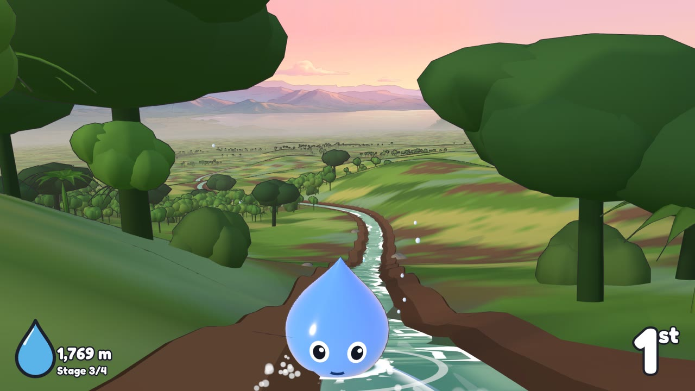 <b>Mount Kerinci</b> Sumatra, Indonesia. From the volcano through the mossy forest to the fields of Bengkolan Dua</td>
<td width="50%" align="center"><b>Surprise us</b> The eighth card in the vote picks one of the seven at random</td>
</tr>
</table>

| Mountain | Summit | Drop | Stages | Race, about |
|---|---|---|---|---|
| Monte Peralba | 2,694 m | 1,693 m | 4 | 3:40 |
| Antelao | 3,264 m | 2,534 m | 5 | 4:30 |
| Matterhorn | 4,478 m | 2,841 m | 4 | 3:20 |
| Văiuga Peak | 2,443 m | 1,747 m | 4 | 3:50 |
| Mount Everest | 8,849 m | 4,424 m | 4 | 3:20 |
| K2 | 8,611 m | 3,573 m | 3 | 2:30 |
| Mount Kerinci | 3,805 m | 2,330 m | 4 | 3:40 |

## Two on one TV

Two phones, split screen. Each drop has its own camera and its own mass.

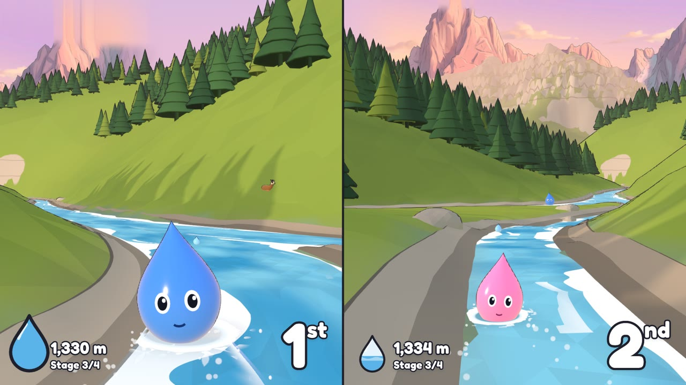

## What a race is made of

Your mass is your life. The current carries you, the stick places you, and BOOST spends you.

<table>
<tr>
<td width="50%">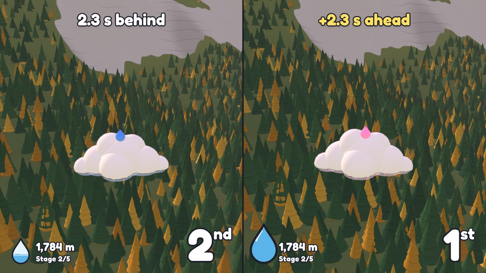 <b>The water cycle.</b> At the end of each stage you evaporate, ride a cloud and rain down on the next one</td>
<td width="50%">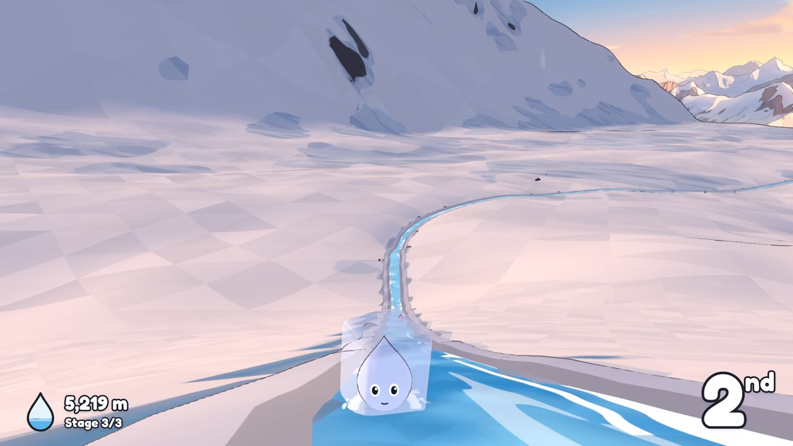 <b>Ice.</b> Stall on ice and you freeze. Tap BOOST again and again to break the cube</td>
</tr>
<tr>
<td width="50%">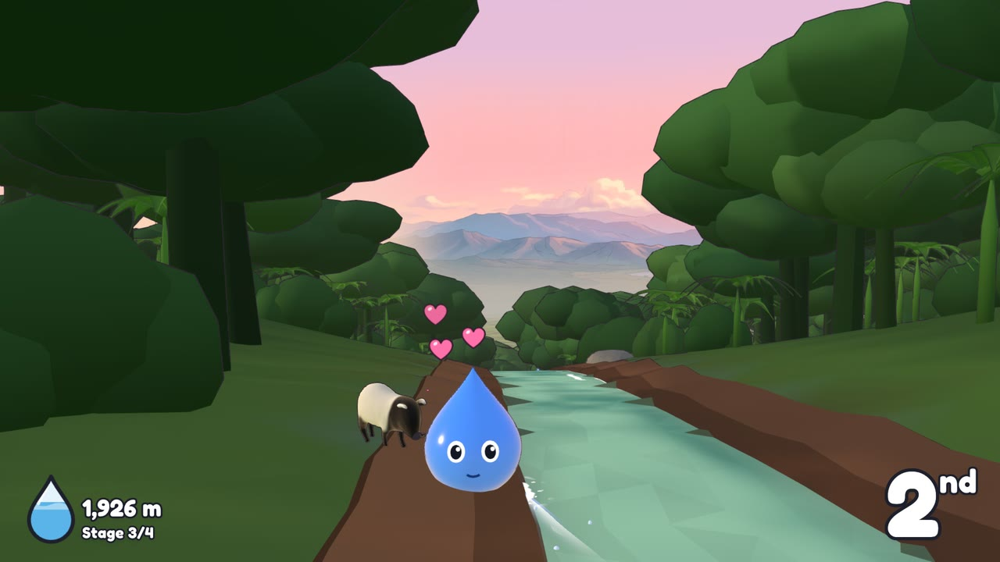 <b>Thirsty animals.</b> A Malayan tapir on Mount Kerinci. Ride the bank or stop, and they come to drink you</td>
<td width="50%">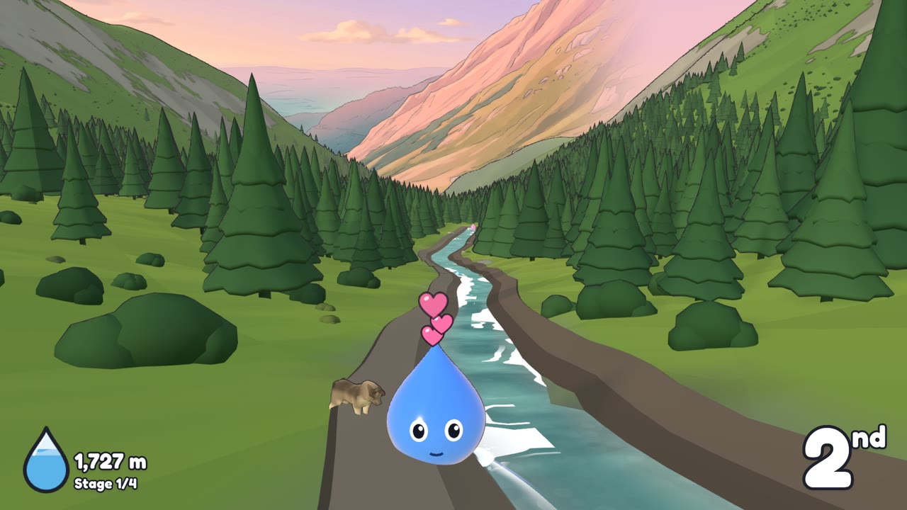 <b>Boost away.</b> On Văiuga Peak. A boost scares them off, and a fast drop in mid stream is left alone</td>
</tr>
</table>

| What | How it works |
|---|---|
| Water | Water drops and rain add mass, up to 4 times your start. More mass is a little faster and steers heavier |
| BOOST | A short burst of speed that costs mass, every 3 s. Boosting through a water drop pays double |
| The other drop | Boost into it and you steal some of its mass |
| Sun and rocks | Both evaporate you faster. Too little mass and you evaporate, then come back at the last checkpoint |
| Forks | Every mountain has a safe branch, out of the sun, and three have a shortcut. Steer into the one you want |
| Off the bed | Climb the bank and the ground slows you. Stay away too long and you are put back |
| Behind? | A small push for the drop behind. The gap at the end of a stage carries into the next, up to 3 s |
| The finish | The first one over the line starts a 30 s clock for the other |

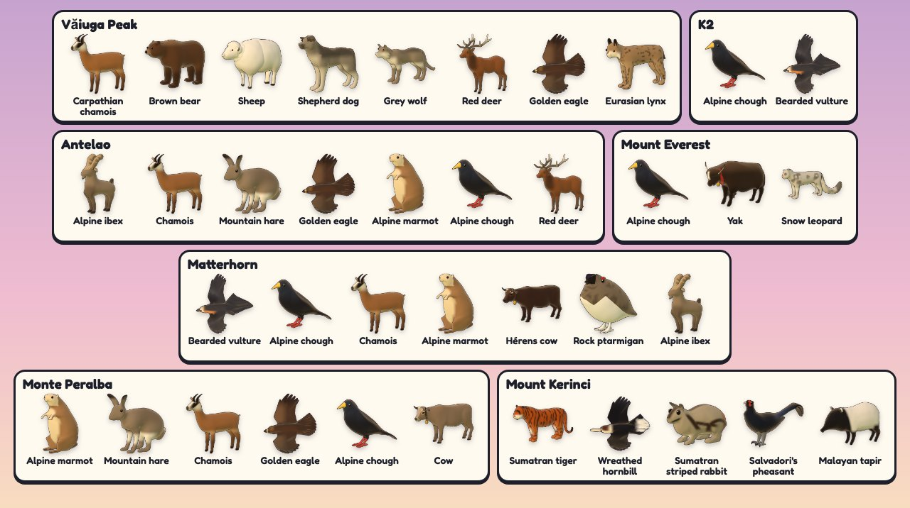

24 kinds of animal live on the courses, mountain by mountain.

## Modes and options

| Option | What is there |
|---|---|
| Mode | **Short:** 3 to 5 steep stages. The lobby also lists **Real**, marked "coming soon": it cannot be played yet |
| Two phones | Split screen. Both vote, then the race starts |
| One phone | Full screen against a bot. Hold BOOST for 1.5 s to start |
| No phone | The keyboard: W A S D and Left Shift for blue, arrows and Enter for pink |
| The vote | The same mountain: off you go. Two different ones: a coin decides. Or Surprise us |
| A late phone | A bot drives the empty seat, and the phone takes over at the next race. A third phone waits for a free seat |
| After the race | Time, stage by stage splits, peak mass and sips lost. Tap BOOST for a rematch, hold it for another mountain |
| Language | English or Italian on the TV, and on each phone on its own |

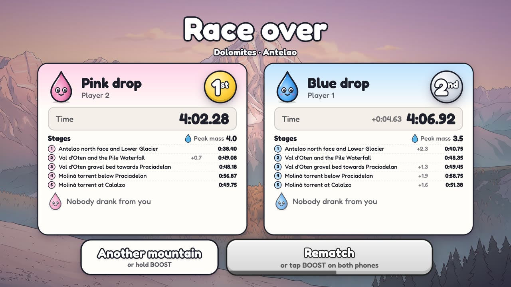

## Start

Needs Node 24 or newer.

| Command | What it does |
|---|---|
| `npm install` | install dependencies |
| `npm run play` | build, start the server and open the browser |
| `npm run build` | bundle into `dist/` (`node build.mjs --dev` for unminified with sourcemaps) |
| `npm start` | start the server. `PORT` changes the port, `LAN_IP` the address in the QR |
| `npm test` | run the tests in `test/` with `node --test` |
| `node tools/bake/index.mjs <id>` | bake one world from `tools/bake/worlds/<id>.json` into `data/worlds/<id>/` |
| `node tools/bake/bake-all.mjs --jobs 3` | bake every world in parallel and refresh `data/worlds/index.json` |

Scan the QR on the TV with each phone. Phones and computer must be on the same Wi-Fi, no HTTPS needed. `docs/testing.md` has what to do when a phone cannot connect.

The browser tests skip themselves when no Chromium headless shell is found (`docs/testing.md`).

## Worlds

`dolomiti`, `antelao`, `svizzera`, `carpazi`, `everest`, `k2`, `indonesia`. The baked worlds are in the repository, so the game plays without baking anything. Config format and data sources are in `docs/world-format.md`, the facts behind each mountain in `docs/mountains/`.

Copernicus elevation tiles live in `data/raw/dem/` and OSM answers in `data/raw/osm/<id>/`, outside git. The bake downloads what is missing.

## Under the hood

| Part | How |
|---|---|
| Rendering | three.js, in the browser on the TV |
| Simulation | deterministic: seeded, in fixed steps of 1/60 s, with no rendering code in it |
| Phones | a web page and a WebSocket to a small Node server on your network |
| Ground | real elevation data, Copernicus DEM GLO-30, at real scale |
| Backdrops | real photos of the real places, repainted in the game's style |
| Animals | third-party models, reshaped and repainted in code when they load |

## Status

A prototype. A full race runs in the browser with scripted pads, but play on real phones is not confirmed.

`npm test`: 391 tests, 336 pass, 8 fail and 47 skip. The failures are left over from unfinished work; the skips need Chromium or the raw data, which stays outside git. Known rough edges: on K2 stage 1 a backdrop floats as a soft patch, and a drinking heart can fill the camera.

Every picture on this page is a real capture of the real game, driven by scripted pads over the real WebSocket with the frame clock stepped by hand (`tools/shoot-readme.mjs`). The TV with phones and the animal sheet are laid out from captures and the game's own stickers (`tools/compose-readme.mjs`).

## Credits and licence

Code: MIT, see `LICENSE`. Painted backdrops: CC BY-SA 4.0, authors file by file in `assets/backdrops/CREDITS.md`. Third-party models: as listed in `assets/CREDITS.md`. The rest, terrain and font included: `CREDITS.md`.

| More | What |
|---|---|
| `docs/specs/2026-10-27-summit-descent-design.md` | the design and every module's contract |
| `docs/testing.md` | playing, when the phone cannot connect, tests, tools |
| `docs/world-format.md` | how a world is baked and what it contains |
