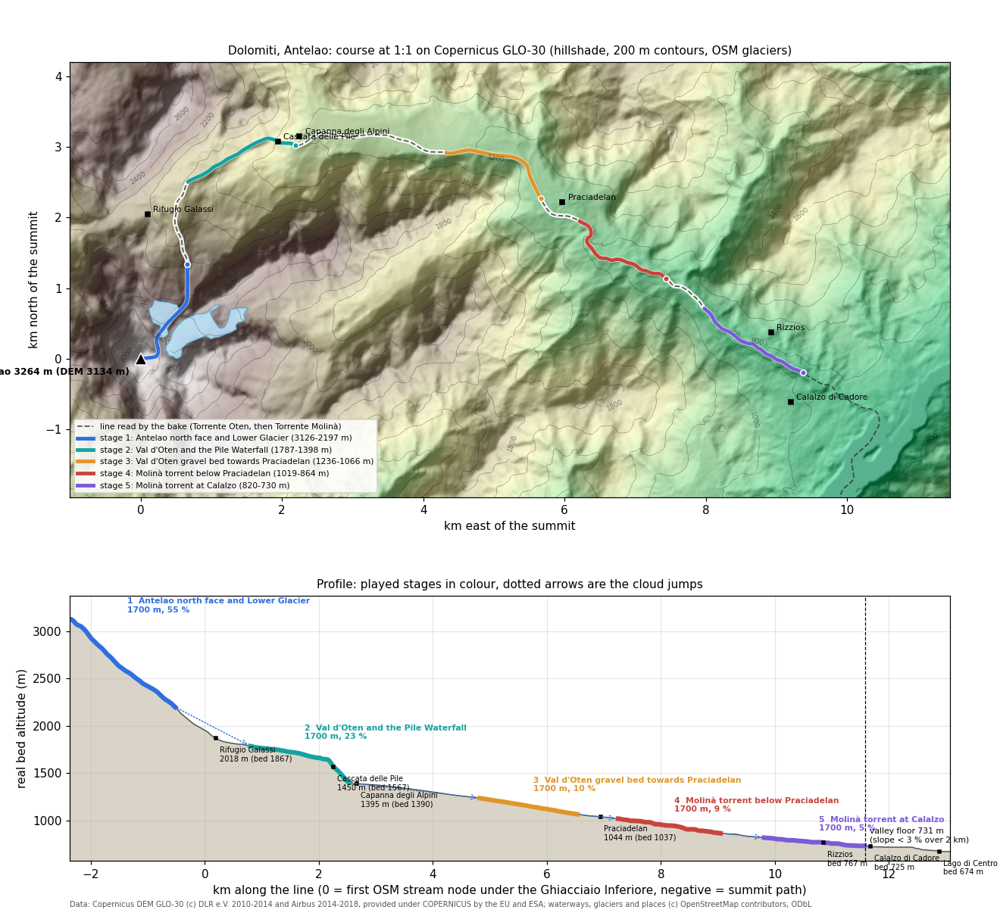

# Dolomites: the Antelao and the Val d'Oten (`antelao`)

The drop starts just under the summit of the Antelao (3264 m), the "re delle Dolomiti" and the second highest peak of the Dolomites, above Calalzo and Pieve di Cadore. It runs down the north face onto the Ghiacciaio Inferiore. The meltwater goes north under Rifugio Galassi into the head of the Val d'Oten, over the Cascata delle Pile and past the Capanna degli Alpini. It then runs east down the braided gravel bed of the Val d'Oten to Praciadelan, and down the Torrente Molinà past Rizzios to Calalzo di Cadore, where the valley opens onto the Piave and the Lago di Centro Cadore. Everything is at real scale, 1:1 in plan and in height. This is the second Dolomites world, next to `dolomiti` (Monte Peralba, the source of the Piave). The Molinà joins that same Piave below Calalzo.

| | |
|---|---|
| Config | `tools/bake/worlds/antelao.json` |
| Baked world | `data/worlds/antelao/` (5 stages, about 4.0 MB) |
| Tests | `test/bake-antelao.test.mjs` (9 tests), plus the generic checks in `test/bake-worlds.test.mjs` |
| Image | `docs/mountains/antelao-profile.png`, made by `python3 tools/mountains/antelao_profile.py` |
| Vote name | "Dolomites, Antelao" / "Dolomiti, Antelao"; finish "Molinà torrent at Calalzo" / "Torrente Molinà a Calalzo" |
| Race | 268 s: two sim bots, 43 + 69 + 50 + 52 + 56 s (seed 3), plus 4 cloud jumps of 3.5 s; 266-272 s over seeds 1 to 7, both bots finish every stage |
| Backdrops | One per view, each from a photo taken there (`assets/backdrops/CREDITS.md`): ahead, `antelao-marmarole.jpg` (stage 1, the Marmarole across the Val d'Oten head), `antelao-galassi.jpg` (stage 2, down the valley from Forcella Piccola) and `antelao.jpg` (stages 3-5, over Calalzo and the Lago di Centro Cadore to the Friulian Dolomites); behind, `antelao-chiggiato.jpg` (the valley UP from Rifugio Chiggiato, the Antelao's north face: the photo "Val oten calalzo" looks west-south-west, uphill, not towards Calalzo); `antelao-summit.jpg`, the south-west face over San Vito, for the lobby card and the results. Late October throughout |



## The line and why

The brief asked for the real water path from the Antelao down its north-east side to Calalzo, matching the painted backdrop of the Val d'Oten. The question is whether the water from the summit area really reaches the Val d'Oten. Steepest descent (D8 on the GLO-30 tile, with small jumps out of pits) was traced from the summit faces and the two glaciers. It was traced once while building the config, and again independently on 28/10:

| Start | Where the water goes | Passes |
|---|---|---|
| North face (46.455 N, 12.262 E, DEM 2885 m) | Val d'Oten, Torrente Molinà, Piave at Calalzo (718 m) | Cascata delle Pile 2 m, Capanna degli Alpini 99 m, Praciadelan 159 m |
| Ghiacciaio Inferiore, centroid (DEM 2531 m) | the same | Rifugio Galassi 389 m, Cascata delle Pile 16 m, Capanna degli Alpini 109 m, Praciadelan 153 m |
| Ghiacciaio Superiore, centroid (DEM 2572 m) | east down a side valley, into the Val d'Oten at Praciadelan, then the same | Praciadelan 172 m |
| North-east and east faces | the Superiore basin (a pit on the DEM at about 1630 m, 46.464 N 12.312 E, then the same side valley) | |
| South face | Valón dell'Antelao to the Boite at Vodo di Cadore (830 m) | Vodo 123 m |
| West face | the Boite near San Vito di Cadore (881 m) | |

So the answer is yes. The north face and the Ghiacciaio Inferiore drain to the Val d'Oten over the Cascata delle Pile, as the brief and the backdrop have it. The Superiore drains to the Val d'Oten too, but by a side valley that joins below the Pile. The south and west sides belong to the Boite. The course follows the Inferiore line. A test pins it: every played point is east of 12.255 E and north of 46.445 N, and the summit stage crosses only the Inferiore outline.

**How the bake reads it.** `descent.kind: "osm-network"` walks the OSM waterways downhill from the first stream node under the Ghiacciaio Inferiore (`descent.start`, 46.462 N 12.2645 E). Where the network branches, it takes the named streams `Torrente Oten`, then `Torrente Molinà`, then `Piave`. The summit path joins the summit to that node through `summitVia` (46.4555 N, 12.264 E), on the north face's fall line.

**Where the race ends.** The valley floor is the first place where the mean slope over the next 2 km drops under 3 % (`short.floor`). That is river km 11.59 at 731 m, in the Molinà bed just above its mouth on the Piave below Calalzo. The fifth stage ends there, at 730 m (`short.stages.end: "floor"`). Downstream the line runs onto the Lago di Centro Cadore (DEM 674 m on the water), which is not played.

**Why `stages.end: "floor"`.** The greedy pick takes the stage windows with the most drop. On this profile it fills the steep top (north face, Pile) and leaves the last window high in the Val d'Oten. The race would then never reach Calalzo, and the brief says "stages ending at the real valley floor". With `end: "floor"` the last window ends on the floor and the others are picked greedily above it. The option is new in `tools/bake/course.mjs`, and the other worlds bake byte for byte as before.

## Stages

River km: 0 is the first OSM stream node under the Ghiacciaio Inferiore; negative is the summit path. Altitudes are the real bed altitude of the baked course.

| # | Stage (it / en) | River km | Altitude | Length | Mean slope | What it crosses |
|---|---|---|---|---|---|---|
| 1 | Parete nord e Ghiacciaio Inferiore dell'Antelao / Antelao north face and Lower Glacier | -2.37 to -0.52 | 3126 to 2197 m | 1700 m | 55 % | the north face from just under the summit, then the Ghiacciaio Inferiore (OSM way 709268796); ice zone from the start down to about 2425 m, named after the glacier |
| 2 | Val d'Oten e Cascata delle Pile / Val d'Oten and the Pile Waterfall | 0.79 to 2.55 | 1787 to 1398 m | 1700 m | 23 % | starts 230 m under the level of Rifugio Galassi (2018 m, on the saddle west of the stream); the head of the Val d'Oten, the Cascata delle Pile (the course passes within 60 m of the OSM node); ends just above the Capanna degli Alpini (1395 m) |
| 3 | Ghiaie della Val d'Oten verso Praciadelan / Val d'Oten gravel bed towards Praciadelan | 4.82 to 6.54 | 1236 to 1066 m | 1700 m | 10 % | the wide gravel bed of the Val d'Oten, running east; a second gravel channel as a safe branch (the braided bed of the photo); a rain zone; ends 400-600 m before Praciadelan (1044 m) |
| 4 | Torrente Molinà sotto Praciadelan / Molinà torrent below Praciadelan | 7.24 to 9.06 | 1019 to 864 m | 1700 m | 9 % | the Molinà in its wooded gorge; the game's shortcut branch (see "What is not real") |
| 5 | Torrente Molinà a Calalzo / Molinà torrent at Calalzo | 9.80 to 11.59 | 820 to 730 m | 1700 m | 5 % | past Rizzios (the course passes 263 m from the hamlet node) to the valley floor below Calalzo di Cadore; a sun zone |

Total drop played: 2396 m in 8.5 km. Between stages the drop evaporates, flies as a cloud and rains on the next start (3.5 s each).

## Named places along the way

| Name | English | Altitude | Where | Source |
|---|---|---|---|---|
| Antelao | Antelao | 3264 m (DEM 3134 m) | start | OSM node 2641912271, Wikipedia |
| Punta Menini, Punta Chiggiato, Cima Fanton | | 3168, 3163, 3140 m | the summit ridge east of the top, above the glaciers | OSM |
| Ghiacciaio Inferiore dell'Antelao | Antelao Lower Glacier | DEM 2411-2782 m | stage 1 | OSM way 709268796 |
| Ghiacciaio Superiore dell'Antelao | Antelao Upper Glacier | DEM 2331-2877 m | east of stage 1, not on the course | OSM way 262363041 |
| Rifugio Pietro Galassi | Galassi hut | 2018 m | on Forcella Piccola's side, west of the stream at the start of stage 2 | OSM relation 19526395, magicoveneto |
| Forcella Piccola | | | the saddle between Antelao and Marmarole above Rifugio Galassi | magicoveneto |
| Cascata delle Pile | Pile Waterfall | about 1450 m (guides; DEM 1567 m at the node, see below) | stage 2 | OSM node 1383481858 |
| Rifugio Capanna degli Alpini | Alpini hut | 1395 m (OSM 1387 m) | end of stage 2 | OSM way 383877715 |
| Val d'Oten | | 1400 to 1040 m | stages 2 and 3 | |
| Praciadelan | | 1044 m | between stages 3 and 4, the road head (Bar alla Pineta, 1050 m) | OSM node 1383482726, volpidelvajolet |
| Torrente Molinà | | | stages 4 and 5 | OSM |
| Rizzios | | | stage 5, a hamlet of Calalzo | OSM node 1427176367 |
| Calalzo di Cadore | | | the finish, on the terrace above the floor | OSM node 64778113 |
| Lago di Centro Cadore | | DEM 674 m | past the floor, not played | OSM |

**DEM against the published heights.** GLO-30 is a 30 m surface model. It shaves the summit pyramid by 130 m (3134 against 3264 m). It also reads the rim of the slot gorge at the Cascata delle Pile, which is only a few metres wide, so the DEM gives 1567 m there against about 1450 m in the guides. The bed altitudes along the course are smoothed from the DEM, so the stage altitudes inherit both offsets.

## Glaciers

Two glaciers survive on the Antelao, both on the north-east side under the summit ridge. A third, the Cianpestrin, has vanished (Wikipedia, citing the Comitato Glaciologico Italiano). The Superiore (Orientale) covered 27 ha in 2010 and is the second largest in the Dolomites. The Inferiore (Occidentale) covered 14 ha in 2010. Each retreated about 106-109 m between 1981 and 2009. On the OSM outlines and the DEM the Inferiore reaches down to about 2410 m and the Superiore to about 2330 m. That is why the render theme puts glacier ice above 2420 m (`src/render/themes/antelao.js`), and the sim's ice zone (`short.iceAbove: 2400`) ends at about 2425 m.

## Vegetation by altitude band

The Natura 2000 site IT3230081 "Gruppo Antelao - Marmarole - Sorapis" (17,069 ha, all Alpine region) covers the whole course above Calalzo. Its standard data form gives the cover of each habitat. Those numbers and the CAI Treviso sheet of the group are the sources of the bands below. The bands are the ones the render theme uses (`src/render/themes/antelao.js`: treeline 1950 m, larch to 2250 m, mugo pine 1350-2300 m, hairy alpenrose 1600-2300 m, beech below 1450 m, grey willow on the gravel below 1300 m, nothing growing above 2400 m).

| Band | What grows | Natura 2000 habitat (cover in the site) | Sources |
|---|---|---|---|
| 3264 to about 2400 m | bare dolomite walls, ledges, screes; the two glaciers; snow in the gullies | 8210 calcareous rock (4883 ha), 8120 calcareous screes (2104 ha), 8340 permanent glaciers (56 ha), 8240 limestone pavements (47 ha) | SDF IT3230081; Wikipedia |
| about 2400 to 1950 m | scree and calcareous grassland, with dense mugo pine (*Pinus mugo*) and hairy alpenrose (*Rhododendron hirsutum*) on the screes; Rifugio Galassi stands in this belt | 4070 *Pinus mugo* and *Rhododendron hirsutum* scrub (2876 ha, the largest vegetated habitat of the site), 6170 calcareous grasslands (1283 ha), 4060 alpine heaths (65 ha) | SDF; magicoveneto ("imponenti mugheti" on the route up to Galassi); CAI Treviso (mugo, dwarf juniper, *Rhododendron hirsutum*, bearberry, *Erica carnea* above the larch) |
| 1950 to about 1200 m | open larch (*Larix decidua*) and spruce (*Picea abies*) woods in groups between meadows, mugo pine on the screes down to the Val d'Oten floor | 9420 larch and Swiss pine forests (1141 ha), 9410 spruce forests (2261 ha) | SDF; CAI Treviso (sparse larch-spruce wood in the subalpine belt around Rifugio Antelao, 1796 m, on the same group) |
| below about 1450 m | spruce mixed with beech (*Fagus sylvatica*): Cadore is in the "mesalpic" district, where moist air from the plain lets beech grow among the conifers | 9130 beech forests (1030 ha), 9150 limestone beech forests (314 ha) | SDF; CAI Treviso |
| the gravel bed of the Val d'Oten and the Molinà | braided gravel channels with herbaceous banks, German tamarisk (*Myricaria germanica*) and grey willow (*Salix elaeagnos*) scrub; grey alder along the lower torrent | 3220 alpine rivers with herbaceous banks (78 ha), 3230 with *Myricaria germanica* (171 ha), 3240 with *Salix elaeagnos* (11 ha), 91E0 alluvial alder forests (6 ha) | SDF |
| the valley floor at Calalzo | mountain hay meadows between spruce and beech woods | 6520 mountain hay meadows (171 ha) | SDF |

## Fauna by altitude band

These are the bands in `animals.kinds` of the config. The bake spawns a species only where the real bed altitude is inside its band, at most `max` per stage. The species list is the CAI Treviso sheet of the group, checked against the Natura 2000 form.

| Species (key) | Band | Spawned on (bed altitude, seed of the bake) | What the sources say | Sources |
|---|---|---|---|---|
| Alpine ibex, *Capra ibex* (`ibex`) | 1800-3264 m, at most 2 | stage 1 (2989 m) | the Antelao-Marmarole-Sorapis colony, from 8 animals released in 1965; monitored by CAI and the Museo di Storia Naturale di Venezia ("Progetto Stambecco"), with Rifugio Galassi as a base; listed in the site's "other species" | montagna.tv, MUVE "Studiamo insieme lo stambecco", CAI Società Alpina delle Giulie (Trieste) / ONC "stambecchi delle Marmarole", SDF |
| Chamois, *Rupicapra rupicapra* (`chamois`) | 900-2800 m, at most 3 | stages 1-4 (2755, 2335, 1668, 1186, 1095, 1000, 913 m) | on the rocky saddles and ledges of the group (CAI); also the forests of conifer and beech broken by rock walls and gullies, normally 1000-2500 m but down to 400-500 m where disturbance is low, below the treeline in winter (Parco Dolomiti Friulane) | CAI Treviso, Parco Dolomiti Friulane fact sheet |
| Alpine marmot, *Marmota marmota* (`marmot`) | 1500-2300 m, at most 1 | stage 2 (1765 m) | small colonies where the soil is deep enough | CAI Treviso |
| Mountain hare, *Lepus timidus* (`hare`) | 1400-2600 m, at most 1 | stages 1, 2 (2580, 1568 m) | present "in tutta la zona" | CAI Treviso |
| Alpine chough, *Pyrrhocorax graculus* (`chough`) | 1500-3264 m, flying low, at most 2 | stage 2 (1743 m) | among the corvids of the group, with the raven | CAI Treviso |
| Golden eagle, *Aquila chrysaetos* (`eagle`) | 700-3264 m, soaring, at most 1 | every stage | nests in the area; listed in the site's birds | CAI Treviso, SDF |
| Red deer, *Cervus elaphus* (`red-deer`) | 700-1900 m, at most 2 | stages 3-5 (1213-774 m) | the main mammal of the subalpine woods and clearings, with the roe deer | CAI Treviso |

**Present, not spawned.** These species are real here but not in the game, for lack of a model: roe deer, red fox, red squirrel, black grouse, rock ptarmigan, capercaillie, hazel grouse, wallcreeper, black woodpecker, adder. The form also lists wolf, lynx and brown bear as present. They range widely and are seldom seen, and a bear on the course would give a false picture of the place, so none is spawned. **No cattle**: the course passes no mapped pasture or malga. The nearest, Casera d'Aieron (1711 m), is on the Marmarole side above the valley. That is why `cow`, which the `dolomiti` world has, is left out here.

## Free 3D model candidates

Every species above is already in the game (`assets/vendor/animals/`, credits in `assets/CREDITS.md`), reshaped and repainted at load time in `src/render/animals/species.js` and `species-carpazi.js`. Nothing new was downloaded for this world.

| Species | Model in game | Licence |
|---|---|---|
| Alpine ibex | "Goat" (horned), Poly by Google, poly.pizza/m/bSetPnvQB5G | CC-BY 3.0 |
| Chamois | "Goat", Poly by Google, poly.pizza/m/d7dImmjtF8E | CC-BY 3.0 |
| Alpine marmot | "Gopher", Poly by Google, poly.pizza/m/2IatILCJa3X (no free marmot model exists) | CC-BY 3.0 |
| Mountain hare | "Jackrabbit", Poly by Google, poly.pizza/m/biNOm96olTH | CC-BY 3.0 |
| Alpine chough | "Raven", Poly by Google, poly.pizza/m/5oae0lwh9fF | CC-BY 3.0 |
| Golden eagle | "Bird" (soaring), Poly by Google, poly.pizza/m/8Ph79kHbt9s | CC-BY 3.0 |
| Red deer | "Stag", Quaternius, poly.pizza/m/tQdzbZ1Cmw | CC0 1.0 |

The roe deer is the obvious next species. The same Quaternius stag, scaled to about 0.6 with short antlers and a grey-brown coat, would cover it without a new download.

## What is not real

A judge checking every element against reality should know these game elements are not in the place:

- **The shortcut in stage 4.** Every world gets one shortcut branch: a channel cut across a bend of the course, with a fall of 8-30 m at its lip (`makeShortcut` in `tools/bake/index.mjs`). Here it cuts a bend of the Molinà with a 29 m fall. OSM maps only two waterfalls in the whole area, the Cascata delle Pile (stage 2) and the Cascata del Pissandro (46.435 N 12.339 E, not on the course). So this fall is a game feature, not a real waterfall. It is a cross-world choice, left as it is.
- **The stream width.** The bed is 12-18 m wide on every stage, for two drops side by side. The real Pile gorge is a slot a few metres wide, and the upper Oten is a small stream.
- **The water on the glacier.** The sim gives the summit stage an ice zone. A real north face and glacier have no channel of running water down them.
- **The weather zones.** Rain over the Val d'Oten gravel and sun at Calalzo (`weather`) are placed for play, not taken from a forecast.

## Sources

- Antelao 3264 m, "seconda cima delle Dolomiti", the two glaciers (Superiore 27 ha, Inferiore 14 ha in 2010, retreat 1981-2009), the Cianpestrin, the Val d'Oten and the Boite: [Wikipedia (it), Antelao](https://it.wikipedia.org/wiki/Antelao).
- Route, altitudes and the Pile gorge (Praciadelan 1040-1050 m, Capanna degli Alpini 1395-1400 m, Cascata delle Pile 1450 m, Rifugio Galassi 2018-2020 m, the torrents Oten and Diassa, "imponenti mugheti"): [magicoveneto, Val d'Oten, Capanna degli Alpini, Cascata delle Pile, Rifugio Galassi](https://magicoveneto.it/dolomiti/Cristallo-Sorapis-Antelao-Marmarole/Antelao-Val-d-Oten-Capanna-degli-Alpini-Cascata-Pile-Rifugio-Galassi.htm); [volpidelvajolet, Capanna degli Alpini and the Pile from Calalzo](https://www.volpidelvajolet.it/2021/07/escursione-rifugio-capanna-degli-alpini.html) (Bar alla Pineta 1050 m, trail 255).
- Habitats and species of the site: Natura 2000 standard data form IT3230081 "Gruppo Antelao - Marmarole - Sorapis", EEA release 62, read from the n2kbackbone API on 27/10/2026 ([site page](https://biodiversity.europa.eu/sites/natura2000/IT3230081)).
- Vegetation and fauna of the group: CAI Sezione di Treviso, sheet of Rifugio Antelao ([csc.cai.it/wp-content/uploads/2017/08/Antelao.pdf](https://csc.cai.it/wp-content/uploads/2017/08/Antelao.pdf)).
- Ibex colony: [montagna.tv, Progetto Stambecco](https://www.montagna.tv/219155/progetto-stambecco-la-citizen-science-per-conoscere-lo-stambecco-del-cadore/), [MUVE, Studiamo insieme lo stambecco](https://msn.visitmuve.it/wp-content/uploads/2022/06/Studiamo-insieme-lo-stambecco.pdf), [CAI Società Alpina delle Giulie / ONC, gli stambecchi delle Marmarole](https://caisag.ts.it/onc-presentazione-escursione-stambecchi-marmarole-2026/).
- Chamois altitudes and forest use: [Parco Naturale Dolomiti Friulane, scheda camoscio](https://www.parcodolomitifriulane.it/wp-content/uploads/2015/06/scheda_camoscio.pdf).
- Peaks, huts, places, waterfalls, glacier outlines and streams: OpenStreetMap via Overpass, 28/10/2026, cached in `data/raw/osm/antelao/` (ODbL).
- Elevation: Copernicus DEM GLO-30, tile N46 E012.
- Independent review, 28/10/2026: the drainage was traced again from the summit faces and both glacier outlines on the DEM (table in "The line and why"). The glacier altitude ranges were read from the DEM inside the OSM outlines. Every spawn altitude above was read from the baked world.

## Rebake

```
node tools/bake/index.mjs antelao --offline          # a few seconds, also refreshes data/worlds/index.json
node --test test/bake-antelao.test.mjs               # about 3 s, two fresh bakes included
python3 tools/mountains/antelao_profile.py           # the image above (needs matplotlib and numpy)
```
