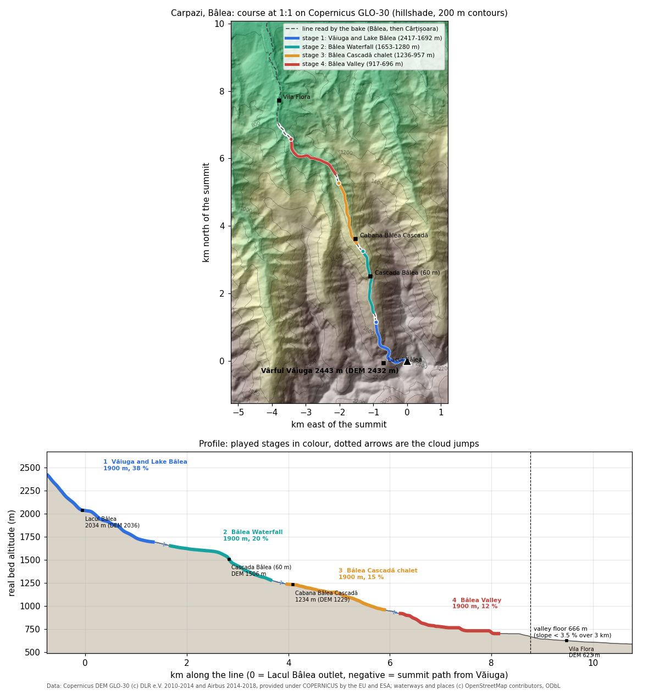

# Carpathians: Văiuga and the Bâlea valley (`carpazi`)

The drop starts on Vârful Văiuga (2443 m) on the main ridge of the Făgăraș. It runs down the west face to the outlet of Lacul Bâlea in its glacial cirque, follows the Bâlea out of the lake, goes over Cascada Bâlea, passes Cabana Bâlea Cascadă and follows Valea Bâlii through the beech woods towards Cârțișoara. Everything is at real scale, 1:1 in plan and in height. This is the valley of the Transfăgărășan road, on the Sibiu side.

| | |
|---|---|
| Config | `tools/bake/worlds/carpazi.json` |
| Baked world | `data/worlds/carpazi/` (4 stages, about 3.4 MB) |
| Tests | `test/bake-carpazi.test.mjs` (8 tests), plus the generic checks in `test/bake-worlds.test.mjs` |
| Image | `docs/mountains/carpazi-profile.png`, made by `python3 tools/mountains/carpazi_profile.py` |
| Vote name | "Carpathians, Bâlea" / "Carpazi, Bâlea"; finish "Bâlea Valley, towards Cârțișoara" / "Valea Bâlii, verso Cârțișoara" |
| Race | 199 s: two sim bots, 56 + 52 + 49 + 56 s (seed 3), plus 3 cloud jumps of 3.5 s; 198-199 s over seeds 1 to 7, both bots finish every stage |



## The line and why

The brief suggested Moldoveanu (2544 m) or Negoiu (2535 m) down a real glacial valley such as Valea Rea, Valea Sâmbetei or the Bâlea. Five lines were read on the Copernicus DEM along the OSM streams:

| Candidate | What the DEM and OSM show | Verdict |
|---|---|---|
| Moldoveanu, north face, Viștea Mare | 4 good stages, 175 s | baked as the `moldoveanu` world, archived on 27/10/2026 (one world per region; config in `tools/bake/worlds/archive/`) |
| Moldoveanu, south face, Valea Rea | 2544 m to Stâna din Valea Rea (about 1460 m) in 4 km, then 1.5 % for 5 km | too flat after the first stage |
| Negoiu, north face, Valea Laiței | only 3 steep stages, 132 s; the floor comes at 690 m | under 3 minutes |
| Valea Sâmbetei | OSM maps the Sâmbăta only from 1496 m; below it the gradient is about 10 % for 7.8 km; the head is under Galbenele and Slănina, not under Moldoveanu | flatter middle, no summit of the brief |
| **Văiuga, Lacul Bâlea, Valea Bâlii** | 4 stages from 11 % to 38 %, 199 s, a glacial cirque, a lake, a 60 m waterfall | **chosen** |

**Why Văiuga and not a higher peak of the Bâlea cirque.** The rule is where a water drop really flows, on a summit the DEM reproduces. Steepest descent on the depression-filled DEM (D8, reviewed 27/10) from the peaks and faces around the cirque gives:
- Vârful Văiuga (2443 m, DEM 2432 m): every face but the south drains to the Bâlea. The summit's own fall line runs north into Căldarea Văiugii and meets the Bâlea at the Văiuga stream confluence, about 1730 m, 1 km below the lake outlet. Water on the west face, from about 2280 m down, runs to the lake outlet.
- Iezerul Caprei (2418 m, DEM 2413 m): the north face drains straight into Lacul Bâlea, the south face to the Capra.
- Vânătarea lui Buteanu (2507 m), 500 m east: its west and north-west faces drain into Căldarea Văiugii and so to the Bâlea, its summit node and east face to the Arpășel. By the water rule it would qualify, but the DEM does not hold it: 2428 m at the OSM node, 79 m under the published height. The highest DEM point within 200 m, 2476 m, is on Capra (2494 m), and its water goes north-east to the Arpășel. A start there fails the 30 m summit check and goes down Căldarea Văiugii, missing the lake.
- Paltinu (2399 m): drains to Pârâul Doamnei.

Văiuga is the highest summit that the DEM reproduces (11 m under) and whose water reaches the Bâlea. The summit is a divide. The first 150 m of the summit path take the west side, towards the lake, while the summit's own fall line goes north. Below about 2280 m the course follows the water to the outlet. Starting from Iezerul Caprei would put the fall line through the lake itself, but the summit is 25 m lower and the race comes out at 196 s. A start on the Văiuga stream instead of the lake would follow the north fall line but drop the lake from the race. Both were baked as probes on 27/10 and rejected.

**Where the race ends.** The valley floor is the first place where the mean slope over the next 3 km drops under 3.5 % (`short.floor`). That is river km 8.8 at 666 m, where Valea Bâlii widens above Vila Flora and the Cârțișoara flats. The race ends 1.4 km above it, at 696 m; the 6 km of valley down to the village are not played.

**Why the stages are packed (`short.stages.pick: "packed"`).** The default pick takes the stage windows with the most drop, greedily. On the Bâlea it took the waterfall and the stretch below Bâlea Cascadă first. That left only the flat beech bottom for stage 4 (773-666 m, 6 %), at 180 s. Packed from the summit, with the same 300 m between stages, all four stages are 11 % or steeper and the race is 199 s. Stage 3 then starts 120 m from Cabana Bâlea Cascadă. The option is new in `tools/bake/course.mjs`; the default is unchanged, so the other worlds bake byte for byte as before.

## Stages

River km: 0 is the outlet of Lacul Bâlea; negative is the summit path from Văiuga. Altitudes are the real bed altitude of the baked course.

| # | Stage (it / en) | River km | Altitude | Length | Mean slope | What it crosses |
|---|---|---|---|---|---|---|
| 1 | Văiuga e Lacul Bâlea / Văiuga and Lake Bâlea | -0.76 to 1.34 | 2417 to 1692 m | 1900 m | 38 % | west face of Văiuga above Șaua Caprei, the outlet of Lacul Bâlea (2034 m, the course passes 30 m from it), the cirque threshold, the confluence with the Văiuga stream from Căldarea Văiugii (about 1730 m); ice zone above 2100 m (snow lies late in the cirque; there is no glacier in the Făgăraș) |
| 2 | Cascada Bâlea / Bâlea Waterfall | 1.66 to 3.65 | 1653 to 1280 m | 1900 m | 20 % | the hanging valley under the cirque, then Cascada Bâlea (60 m, river km 2.83); a safe arm |
| 3 | Bâlea Cascadă / Bâlea Cascadă chalet | 3.96 to 5.89 | 1236 to 957 m | 1900 m | 15 % | starts at Cabana Bâlea Cascadă (1234 m), the lower cable car station; spruce, then mixed forest |
| 4 | Valea Bâlii / Bâlea Valley | 6.19 to 8.14 | 917 to 696 m | 1900 m | 12 % | beech woods of Valea Bâlii; a shortcut with an 8.6 m waterfall |

Total drop played: 1721 m in 7.6 km. Between stages the drop evaporates, flies as a cloud and rains on the next start (3.5 s each).

## Named places along the way

| Local name | Italian | English | Altitude | Where |
|---|---|---|---|---|
| Vârful Văiuga | Monte Văiuga | Văiuga Peak | 2443 m | start |
| Șaua Caprei | Sella della Capra | Capra Saddle | 2315 m | 300 m south-west of the summit, on the ridge |
| Căldarea Văiugii | Circo della Văiuga | Văiuga cirque | about 1750-2300 m | north of the summit, between Văiuga, Vânătarea lui Buteanu and Netedu; not on the course, but its stream joins the Bâlea on stage 1 (about 1730 m) |
| Lacul Bâlea | Lago Bâlea | Lake Bâlea | 2034 m | stage 1, river km 0 |
| Cabana Bâlea Lac, Telecabina Bâlea Lac | Rifugio Bâlea Lac, funivia | Bâlea Lac chalet, cable car | about 2030 m | on the lake shore, stage 1 |
| Cascada Bâlea | Cascata di Bâlea | Bâlea Waterfall | 60 m high; DEM 1506 m at the OSM point | stage 2, river km 2.83 |
| Cabana Bâlea Cascadă | Rifugio Bâlea Cascadă | Bâlea Cascadă chalet | 1234 m | start of stage 3, river km 4.09 |
| Valea Bâlii | Valle del Bâlea | Bâlea Valley | 1234 to about 600 m | stages 3 and 4 |
| Vila Flora | | | DEM 623 m | river km 9.5, past the floor |
| Cârțișoara | Cârțișoara | Cârțișoara | | the village at the valley mouth, river km 16 |

OSM names the river the Bâlea from the lake to 300 m into stage 4, and the Cârțișoara below, a left tributary of the Olt. Only the summit and the villages are in `world.json` `places`: the bake takes OSM `place=*` nodes, and the lake, the waterfall and the chalets are tourism nodes.

## Fauna by altitude band

These are the bands in `animals.kinds` of the config. The bake spawns a species only where the real bed altitude is inside its band. Species and bands are a first draft (spec "Animali: specie vere"). The Natura 2000 standard data form of ROSCI0122 Munții Făgăraș did not render through the fetcher on 27/10. It is the source to check the bands against.

| Species (key) | Band | Spawned on | What the sources say | Sources |
|---|---|---|---|---|
| Carpathian chamois, *Rupicapra rupicapra carpatica* (`carpathian-chamois`) | 1400-2550 m, at most 3 per stage | stage 1 | Făgăraș, Retezat, Rodnei and Bucegi hold the Romanian population (about 6,800 animals in 2006); alpine meadows and rock above the forest. IUCN Least Concern | [Romania Insider, the chamois in the Făgăraș](https://www.romania-insider.com/chamois-romania-fagaras), [Wikipedia, Chamois](https://en.wikipedia.org/wiki/Chamois) |
| Brown bear, *Ursus arctos* (`brown-bear`) | 600-2200 m, at most 1 | stages 1-4 | Bears come up to the Transfăgărășan and Bâlea Lac every summer; the road authority warns of bears on the road when it opens | [Profit.ro, CNAIR warning on the Transfăgărășan](https://profit.ro/povesti-cu-profit/auto-transporturi/transfagarasanul-se-deschide-circulatiei-sambata-cnair-atentioneaza-ca-este-semnalata-prezenta-ursilor-in-apropierea-partii-carosabile-19046672), [Economedia, bear attacks on the Transfăgărășan](https://economedia.ro/?p=266495) |
| Eurasian lynx, *Lynx lynx carpathicus* (`lynx`) | 600-1800 m, at most 1 | stages 3, 4 | Camera trapping by Foundation Conservation Carpathia in the eastern Făgăraș, Piatra Craiului and Leaota (2018-2020): 23 adults and 9 kittens on 1,200 km² of forest | [Romania Insider, FCC lynx monitoring](https://www.romania-insider.com/society/fcc-lynx-monitoring-oct-2020), [Scientific Reports 2021 (PMC8085240)](https://www.ncbi.nlm.nih.gov/pmc/articles/PMC8085240/) |
| Grey wolf, *Canis lupus* (`wolf`) | 600-2200 m, at most 2 | stages 2-4 | One of the large carnivores of the Făgăraș protected by the Natura 2000 site and monitored by FCC | [Foundation Conservation Carpathia](https://carpathia.org/?p=8722), [EUNIS, ROSCI0122](https://eunis.eea.europa.eu/sites/ROSCI0122) |
| Red deer, *Cervus elaphus* (`red-deer`) | 600-1900 m, at most 2 | stages 2-4 | Forest and forest edge; FCC reports that poaching left only scattered herds of chamois and red deer in large parts of the Făgăraș | [Foundation Conservation Carpathia](https://carpathia.org/?p=8722) |
| Sheep of the stâna (`sheep`) | 1400-2200 m, ground under 35 % slope, at most 2 | stage 1 | Summer flocks on the alpine pastures of the Făgăraș, guarded by shepherds and dogs (still to confirm on a source for the Bâlea cirque itself) | spec table |
| Romanian Carpathian shepherd dog, *Ciobănesc Românesc Carpatin* (`sheepdog`) | 1400-2200 m, ground under 35 % slope, at most 1 | stage 1, with the sheep | Livestock guardian of the Carpathian shepherds, wolf grey, 32-45 kg; FCI breed 350 since 2015 | [Wikipedia](https://en.wikipedia.org/wiki/Carpathian_Shepherd_Dog), [FCI 350](https://www.fci.be/en/nomenclature/CARPATHIAN-SHEPHERD-DOG-350.html) |
| Golden eagle, *Aquila chrysaetos* (`eagle`), not in the spec list | 800-2550 m, flying, at most 1 | stages 2, 3 | 30 to 50-60 breeding pairs in Romania (2012), in the high Carpathians including the Făgăraș | [Romania Insider, the golden eagle](https://www.romania-insider.com/nature-fagaras-mountains-golden-eagle) |

The game already models the golden eagle as `eagle`, so the key is shared with the Dolomiti.

## Look

What the renderer draws on this world (`src/render/themes/carpazi.js`), band by band, and the source behind each element. Altitudes are real metres; the screens are `docs/screens/world-carpazi-s0.png` to `-s3.png` and `world-carpazi-hero.png`.

| Element | Where | What is drawn | Source |
|---|---|---|---|
| Painted backdrop | every stage, ahead | the Bâlea valley looking north from near Lake Bâlea, opening onto the Făgăraș depression; 80 deg wide, centred 10 deg right of each stage's downhill heading, so the views at the end of stage 1 (due north) and of stage 4 stay on the painting instead of its mirrored edge | `File:Valea Balea.jpg` (AnaZ, CC BY 2.5), `assets/backdrops/CREDITS.md` |
| Summit painting | behind the start | Lake Bâlea and its cirque with Cabana Bâlea Lac | `File:Lake Bâlea and Cabana Bâlea.jpg` (Mercy, CC BY-SA 3.0) |
| Alpine grass | up to the ridge (alpine 2380 m) | short green grass, no scree belt: scree only under the steepest walls | the source photos (green to the ridge); [Sibiu tourism, Făgăraș](https://www.sibiu-turism.ro/Nature-and-Heritage-The-Mountains-The-Fagaras-Mountains.aspx), [DEIMS, Făgăraș alpine zone](https://deims.org/c5325a5f-ac3e-450f-a8be-a928cfe5cee8) (Carex curvula, Juncus trifidus alpine, Festuca, Nardus subalpine) |
| Rock | slopes over about 48-62 deg, lower up near the ridge | grey mica schist with a green-grey lichen cast, in small broken outcrops (`coverNoise` 16 m); also the walls of the gorges and of the waterfall step down to 900 m | the source photos (grey crystalline schist outcrops and boulders, no dolomite); docs above (Făgăraș crystalline) |
| Snow | above about 2420 m and on gentle ground only | a few late patches under the summit, no snowfield and no glacier | the summit photo (small patches in the gullies); there is no glacier in the Făgăraș |
| Dwarf mountain pine (jneapăn, *Pinus mugo*) | 1600-2250 m | dark low mounds in patches | [EUNIS F2.462, Carpathian alpenrose mountain pine scrub](https://eunis.eea.europa.eu/habitats/22511) (Romanian high massifs above 1600-1700 m on the north side) |
| *Rhododendron myrtifolium* | 1700-2350 m | low mounds among the pine | the same EUNIS habitat (the regional endemic of this scrub) |
| Juniper (*Juniperus communis* subsp. *alpina*) | 1650-2300 m | low mounds | [Sibiu tourism](https://www.sibiu-turism.ro/Nature-and-Heritage-The-Mountains-The-Fagaras-Mountains.aspx) (mountain pine, juniper, blueberry above the forest) |
| Spruce treeline | 1750 m (soft edge) | the forest stops; trees shrink over the last 250 m | [Romania Insider, subalpine spruce forests](https://www.romania-insider.com/fagaras-subalpine-spruce-forests) (spruce up to about 1800 m); world.json `look.treeline` |
| Spruce (*Picea abies*) | 1300-1800 m pure, 700-1350 m in the mix | tiered conifers, the only tree at the forest line | [Romania Insider, mixed mountain forests](https://www.romania-insider.com/nature-fagaras-mixed-mountain-forests) |
| Beech (*Fagus sylvatica*), silver fir (*Abies alba*) | beech up to 1450 m, the most common kind under about 1100 m; fir 700-1450 m | round crowns on straight stems; darker tiered fir | the same source (mixed beech, fir and spruce from 1000 to 1500-1600 m, more beech lower down) |
| Forest cover | below the treeline | closed canopy (`trees.cover` 0.55) on slopes up to 52 deg, down to 4-12 m from the bank: Valea Bâlii is forested to the river | the source photo (dark continuous forest in the lower valley) |
| Water | the Bâlea | clear green-blue over grey stones, not glacial milk | no glacier feeds it; OSM waterway Bâlea / Cârțișoara |
| Banks and bed | along the stream | grey schist stones, not terracotta earth | the source photos |
| Animals | per stage | the species and bands of the table above (baked into `world.json`; sheep and sheepdog only on stage 1, under 35 % slope) | "Fauna by altitude band" above; the sheep of the Bâlea cirque itself are still unconfirmed by a source |

Known limits: the painting is one view, from about 2050 m. On stage 4 (900-700 m) its high alpine walls still stand above the forested ridges ahead, which the real lower valley does not show; and in the first seconds of stage 1 the camera looks west, past the painting's left edge, onto its mirrored continuation.

## Free 3D model candidates

The spec's rules apply: free models only (CC0 or CC-BY), the same body plan when the species itself is missing, reshaped and repainted at load time in `src/render/animals/species.js`, and never primitives. Nothing was downloaded for this doc. Poly Pizza licences, triangle counts and the animated flag come from the model pages. Sketchfab licences and face counts come from the Sketchfab API (downloadable models, 27/10; downloads need a login). "In game" means the model is already in `assets/vendor/animals/`.

| Species | Candidate | Licence | Notes |
|---|---|---|---|
| Carpathian chamois | [Goat, Poly by Google](https://poly.pizza/m/d7dImmjtF8E) | CC-BY 3.0 | in game as `chamois` (same species): map `carpathian-chamois` to it, maybe darker winter coat |
| | [Chamois, yoshi2024-2025 (Sketchfab)](https://sketchfab.com/models/3c4eb978b2ed4bd494b265caf0f44e9c) | CC-BY | 18,084 faces, the species itself |
| | [Chamois "Rupicapra rupicapra", MUVHN (Sketchfab)](https://sketchfab.com/models/8c279797eed148ddac38f6e78b73e27f) | CC-BY | museum scan, 3.3 M faces: decimate |
| Brown bear | [Brown Bear (animated), andrey. (Sketchfab)](https://sketchfab.com/models/2f59c850fa4e46c08c3c72dd99a63c4b) | CC-BY | 147,637 faces, 1 animation, the species: best base, decimate |
| | [bear, kylekip (Sketchfab)](https://sketchfab.com/models/d9b82655d8784ad59d657bb927097634) | CC-BY | 12,126 faces, game-sized |
| | [Bear, jiang liu](https://poly.pizza/m/3Eb9oLfZYIc) | CC-BY 3.0 | 5,110 triangles |
| | [Bear, Poly by Google](https://poly.pizza/m/a4hZyH8vVph) | CC-BY 3.0 | 1,360 triangles, faceted: smooth with the subdivide pass |
| Eurasian lynx | [Rigged Lynx Model, DupWup (Sketchfab)](https://sketchfab.com/models/18f95047351f41a482bb21505c21bba0) | CC-BY | 23,048 faces, rigged |
| | [lynx, victory_ (Sketchfab)](https://sketchfab.com/models/aff6767399cf4daca1a82b43ccaa1252) | CC-BY | 1,364 faces, 8 animations; check that it is not boxy |
| | [Lynx lynx, Mammal Research Institute PAS (Sketchfab)](https://sketchfab.com/models/6a287f0187a24334a8d0606fef48346e) | CC-BY | scan, 717,663 faces: decimate |
| | [Bobcat, Poly by Google](https://poly.pizza/m/bvsVdF1hLme) | CC-BY 3.0 | 1,034 triangles, same body plan (short tail, ear tufts): repaint spotted grey |
| | [Cat, Quaternius](https://poly.pizza/m/2f54vbV0In) | CC0 | animated, stylised: lengthen the legs, add tufts and a stub tail |
| Grey wolf | [Wolf, Quaternius](https://poly.pizza/m/P1gU3Qkr9r) | CC0 | 1,928 triangles, animated: best base |
| | [Wolf, Quaternius](https://poly.pizza/m/XU7oNeKShV) | CC0 | 2,740 triangles, animated |
| | [Wolf, Poly by Google](https://poly.pizza/m/cx7dMDUDzhG) | CC-BY 3.0 | 1,286 triangles |
| Red deer | [Deer-red, Suiteofart (Sketchfab)](https://sketchfab.com/models/8aeb5a061f084ae1b0b205855b280d1f) | CC-BY | 9,872 faces, 41 animations, the species: best base |
| | [Red deer 3d, SnowCrow (Sketchfab)](https://sketchfab.com/models/2aacd34e7c0e43908053f54851ef3190) | CC-BY | 94,048 faces |
| | [Elk, Poly by Google](https://poly.pizza/m/bO8XPdrAb5G) | CC-BY 3.0 | 1,644 triangles, an antlered stag body |
| | [Deer, Poly by Google](https://poly.pizza/m/3Nv7fblw7oR) | CC-BY 3.0 | 2,014 triangles |
| Sheep | [Sheep, Quaternius](https://poly.pizza/m/C39AUXUUes) | CC0 | 610 triangles, static |
| | [Sheep, Poly by Google](https://poly.pizza/m/9nvBoaVZuX2) | CC-BY 3.0 | 1,304 triangles |
| | [Sheep, kenchoo (Sketchfab)](https://sketchfab.com/models/08b05ae799d947f1a68c49b2d661eb53) | CC-BY | 2,290 faces, 1 animation |
| Carpathian shepherd dog | **no model of the breed** (Sketchfab "sheepdog" is cartoon characters only) | | |
| | [Husky, Quaternius](https://poly.pizza/m/wcWiuEqwzq) | CC0 | 1,822 triangles, animated, the same wolf-like body: repaint wolf grey, heavier head and neck |
| | [Wolf, Quaternius](https://poly.pizza/m/P1gU3Qkr9r) | CC0 | the same body as the wolf above with a dog's coat |
| | [Dog, Quaternius](https://poly.pizza/m/2kUk0QqpCg) | CC0 | 3,604 triangles, animated |
| Golden eagle | [Bird (soaring), Poly by Google](https://poly.pizza/m/8Ph79kHbt9s) | CC-BY 3.0 | in game as `eagle` |
| | [Golden eagle, Poly by Google](https://poly.pizza/m/2YF1DGWp4vx) | CC-BY 3.0 | 1,568 triangles, perched |
| | [Golden eagle, Wirtualne Muzea Małopolski (Sketchfab)](https://sketchfab.com/models/dd0552b1f93b441cbdd626a5b2abebbf) | CC0 | museum scan, 181,130 faces |

**Not used: Kenney.** Its 3D animals are the "Cube Pets" set, cubic, the boxy look the spec rejects. **Quaternius** has the wolf, husky, dog, cat and sheep above. Its "Ultimate Animated Animals" pack (CC0, 12 animals) does not list its species on the page; check it for a deer before taking a CC-BY one.

**Species with no smooth, non-boxy model of their own:** only the **Carpathian shepherd dog**. Derive it from the Quaternius Husky or Wolf. The low-poly Poly by Google bear, bobcat, deer and sheep are faceted but not boxy; the subdivide pass the renderer already uses smooths them.

## Sources

- Vârful Văiuga 2443 m, Lacul Bâlea 2034 m (360 x 190 m, 4.7 ha), the Bâlea glacial cirque: [Wikipedia, Bâlea Lake](https://en.wikipedia.org/wiki/B%C3%A2lea_Lake), [Munții Făgăraș, alpine lakes](https://muntii-fagaras.ro/en/alpine-lakes), [Sibiu City App, Căldarea glaciară Bâlea](https://www.sibiucityapp.ro/en/places/caldarea-glaciara-balea-8c3rqgomkyqfga?page=9); OSM `ele=2443` on the Văiuga node.
- Cascada Bâlea, 60 m; Cabana Bâlea Cascadă at 1234 m: [Sibiu City App, Cascada Bâlea](https://www.sibiucityapp.ro/en/places/cascada-balea--pglzz8l-ijlga?page=9).
- Negoiu 2535 m and Moldoveanu 2544 m: [Wikipedia, Negoiu Peak](https://en.wikipedia.org/wiki/Negoiu_Peak); Valea Rea route and Stâna din Valea Rea at 1460 m: [Romania Insider, routes to Moldoveanu](https://www.romania-insider.com/discover/routes-moldoveanu-peak-travel).
- The Cârțișoara as a left tributary of the Olt: [Wikipedia, Cârțișoara (river)](https://en.wikipedia.org/wiki/C%C3%A2r%C8%9Bi%C8%99oara_(river)).
- Peak, saddle and stream positions: OpenStreetMap via Overpass, 27/10/2026 (Văiuga `ele=2443`, Vânătarea lui Buteanu 2507, Capra 2494, Iezerul Caprei 2418, Șaua Caprei 2315; Cascada Bâlea `height=60`; the Văiuga stream is OSM way 284417796, unnamed).
- Independent review, 27/10/2026: the GLO-30 tile was sampled outside the bake along all four stages (bed within 12 m of the DEM, except for 300 m in the forested gorge of stage 4, where the DSM reads the canopy 15-28 m above the carved bed), drainage was traced on the depression-filled DEM from the cirque peaks, and every model licence above was checked against the Sketchfab API and the Poly Pizza pages.

## Rebake

```
node tools/bake/index.mjs carpazi --offline          # 2 s, also refreshes data/worlds/index.json
node --test test/bake-carpazi.test.mjs               # about 25 s, two fresh bakes included
python3 tools/mountains/carpazi_profile.py           # this page's image (node + matplotlib)
```

The OSM cache is in `data/raw/osm/carpazi/` (`river.json`, `places.json`); the DEM tile is `N45_E024`, shared with the archived `moldoveanu`.

Credits: elevation from the Copernicus DEM GLO-30, (c) DLR e.V. 2010-2014 and (c) Airbus Defence and Space GmbH 2014-2018, provided under COPERNICUS by the European Union and ESA. Waterways and places (c) OpenStreetMap contributors, ODbL.
