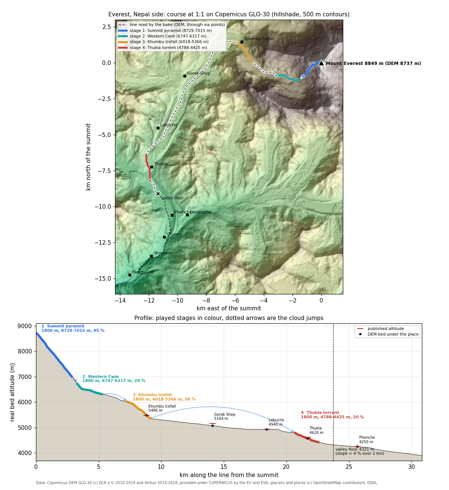

# Everest, Nepal side

World id `everest`. Config `tools/bake/worlds/everest.json`, baked world `data/worlds/everest/`, test `test/bake-everest.test.mjs`. Researched and baked on 27/10/2026.



The image comes from `python3 tools/mountains/everest_profile.py`. It reads the baked world and the whole line from `tools/mountains/line.mjs`, offline.

## The line and why

A drop on the summit runs down the **south-west face**, straight into the **Western Cwm**. That face is the real fall line on the Nepal side. The climbers' route over the South Col follows the south-east ridge and then the Lhotse face, and water does not run along a ridge, so the course does not use it: the South Col (7906 m) stays 1.7 km south-east of the line.

From the Cwm the line follows the ice: the **Khumbu Icefall**, then the **Khumbu Glacier** past Base Camp, Gorak Shep and Lobuche. It leaves the glacier at its snout and drops over the **Thukla** (Dughla) moraine step into the **Lobuche Khola** (OSM `Lobuche`, way 45362027; also called the Khumbu Khola), the stream that runs to the **Pheriche** flats and then, through the Imja Khola, to the Dudh Kosi.

OSM has no stream on the ice, so the line is a least-cost downhill path on the Copernicus DEM (`descent.kind: dem`) through 21 via points on the real thalweg, ending at Pangboche (`descent.to`). Three fixes shaped it:

| Change | Why |
|---|---|
| 15 via points from the summit down the south-west face, the Cwm and the Icefall to Base Camp | The first line slid down the edge of the south-west ridge: 18 of its points between the summit and 6600 m had ground falling away on both sides, which is a crest, not a fall line. Nine variants were baked and scored (ridge points, side-hill points, sharp turns, any climb); the chosen one has no ridge point, the fewest side-hill points (12, against 20-35 for the others) and no climb. It reaches 6600 m after 2.2 km instead of 3.1 km, because it drops straight down the face |
| Via points at the glacier snout (27.940, 86.810), Thukla (27.9225, 86.804) and down the Khumbu Khola | An older point at 27.9265, 86.8239 sat on the lateral moraine: the line climbed 300 m (4925 to 5262 m) before dropping to Pheriche |
| `floor.after: 21000`, `slope: 0.04`, `window: 2000` | The debris-covered glacier between Gorak Shep and Lobuche runs at 0-3 %. That is ice, not the valley floor, so the floor search starts below the snout. The first stretch under 4 % over 2 km is the Pheriche flats |

Below Pheriche the valley steepens again (6-8 % to Pangboche) and then drops into the Imja Khola gorge. Pheriche is where the valley really flattens, so it is the floor. Pangboche stays out of the played part.

## Course

The race lasts **202 s** (3 min 22 s): 191 s of racing for two bots in the real sim, plus 3.5 s of cloud for each of the 3 transitions (`data/worlds/index.json`). There are 4 stages of 1800 m each, 7.2 km played in total.

| # | Stage (it / en) | km on the line | Bed altitude | Drop | Mean slope | Zones |
|---|---|---|---|---|---|---|
| 1 | Piramide sommitale / Summit pyramid | 0.00-2.85 | 8729 → 7015 m | 1714 m | 95 % (44°) | ice (snowfield) |
| 2 | Valle del Silenzio / Western Cwm | 3.26-5.25 | 6747 → 6317 m | 430 m | 24 % | ice, Khumbu Glacier; one arm |
| 3 | Seraccata del Khumbu / Khumbu Icefall | 7.30-9.15 | 6018 → 5366 m | 652 m | 36 % | ice, Khumbu Glacier |
| 4 | Lobuche Khola a Thukla / Lobuche Khola at Thukla | 20.70-22.55 | 4788 → 4425 m | 363 m | 20 % | sun, rain |

- **Slope** is the drop over the 1800 m of the played course in plan.
- **km on the line** is the raw DEM path. On the face that path zigzags across the 30 m grid, so stage 1 covers 2.85 km of raw path but only 1.8 km in plan. Below the Cwm the two agree within 6 %. The profile in the image uses the same km, which is why stage 1 looks less steep there than its 95 %.
- **Stage 1 is a real 44° face.** The bots finish it in about 61 s, with about 13 s each in the air and one off-course respawn. It is the wildest stage of any world so far.
- **Cloud jumps:** 0.3 km in plan from stage 1 to 2, 1.9 km from 2 to 3, and 10.0 km from 3 to 4. The last jump skips the flat glacier past Gorak Shep and Lobuche.
- **Finish:** 4425 m, just below Thukla. The index calls it "Sotto Thukla, verso Pheriche" / "Below Thukla, above Pheriche" (`finish.names`).
- **Valley floor:** km 23.7, 4321 m, at the head of the Pheriche flats.

The stages are picked by drop (`chooseStages`), so the last one is the Thukla step and not the flats below it. Stage 4 already ends 104 m above the floor.

## Places and published altitudes

| Place (en / it / local) | Published | DEM bed under the line | km, stage, distance from the line |
|---|---|---|---|
| Mount Everest / Everest / सगरमाथा Sagarmatha, ཇོ་མོ་གླང་མ Chomolungma | 8848.86 m (China-Nepal survey 2020) | 8737 m (the 30 m DEM shaves the summit) | km 0, start of stage 1 |
| Western Cwm / Valle del Silenzio | 6000-6800 m | 6747-6317 m on stage 2 | stage 2 |
| Khumbu Icefall / Seraccata del Khumbu / खुम्बु आइसफल | 5486 m (OSM `ele`) | 5479 m | km 8.85, stage 3, 269 m |
| Gorak Shep / Gorak Shep / गोरक शेप | 5164 m (OSM `ele` 5175 m) | 5076 m | km 14.1, cloud jump 3 → 4, 599 m |
| Lobuche / Lobuche / लोबुचे | 4940 m (OSM `ele` 4910 m) | 4925 m | km 18.4, cloud jump 3 → 4, 518 m |
| Thukla / Thukla / दुघ्ला Dughla | 4620 m | 4569 m | km 21.7, stage 4, 154 m |
| Pheriche / Pheriche / फेरिचे | 4250 m (HRA aid post); Wikipedia gives 4371 m | 4245 m | km 25.7, 2 km below the floor, 264 m |
| Dingboche / Dingboche | 4410 m (OSM `ele`) | not on the line | in the Imja valley, 1.3 km east |
| Churo, Shomare | Shomare 4060 m (OSM `ele`) | 4132 m, 3997 m | km 27.3 and 29.3, not played |
| Pangboche / Pangboche | 3930 m (OSM `ele`) | 3905 m | km 30.9, end of the line read |

Notes:
- The places come from OSM via Overpass (`data/raw/osm/everest/places.json`); the Nepali names come from their `name` tags.
- OSM has no node for Everest Base Camp on this side, so it is missing from `world.json`; only `placesFallback` lists it.
- "The Balcony" (8400 m) is on the south-east ridge, 0.8 km from the line. The Tibetan Steps and the Hillary Step are excluded (`placeExclude`).
- The test checks these numbers:
  - the DEM summit is within 150 m of 8848.86;
  - the finish lies between Thukla and Pheriche;
  - the floor is within 100 m of Pheriche;
  - stage 2 ends in the Cwm band;
  - stage 3 spans 5486 m.

## Fauna by altitude

These are the bands in `animals.kinds`. A spawn has to fall inside its band (bake check, ±150 m in `test/bake-worlds.test.mjs`). Where a field study in Sagarmatha NP itself exists, the band follows that study and not the species' whole Himalayan range, and `test/bake-everest.test.mjs` holds the bands to it (at most 100 m above the recorded top).

| Species | Band | Real range and source | Where it can appear |
|---|---|---|---|
| Alpine chough (*Pyrrhocorax graculus*) | 3500-8200 m | follows climbers to 8200 m on Everest and nests at 6500 m ([Wikipedia](https://en.wikipedia.org/wiki/Alpine_chough)) | every stage (2 per stage) |
| Yak (*Bos grunniens*, domestic) | 3000-5400 m | herded on the Khumbu summer pastures; yak trains carry loads to Gorak Shep ([UNESCO, Sagarmatha NP](https://whc.unesco.org/en/list/120)) | stage 4 |
| Snow leopard (*Panthera uncia*) | 3000-5100 m | grazing land and shrubland at 3000-5000 m since its return to the park ([Ale, Yonzon and Thapa 2007, Oryx 41:89](https://media.rufford.org/media/project_reports/Oryx%20Vol%2041%20No%201%20January%202007.pdf)) | stage 4 (at most 1); never on the Icefall |
| Himalayan tahr (*Hemitragus jemlahicus*) | 3000-4400 m | recorded at 3685-4380 m in Sagarmatha NP, mean 4059 m ([Shrestha 2007, Nepal Journal of Science and Technology](https://nepjol.info/index.php/NJST/article/view/568)) | **never**: stage 4 ends at 4425 m, above the highest record |
| Danphe, Himalayan monal (*Lophophorus impejanus*) | 2400-4100 m | national bird of Nepal; across the Himalaya 2100-4500 m, but in Sagarmatha NP found only at 3250-4021 m, in pine forest ([Paudel et al. 2023, Banko Janakari 33:1](https://www.nepjol.info/index.php/BANKO/article/view/56503)) | **never**: the course is above the treeline |
| Red panda (*Ailurus fulgens*) | 2200-3700 m | lower forests, 3000-3200 m preferred in the park ([GRID-Arendal](https://beta.grida.no/?p=4343)) | **never**: the course stops at 4425 m |

On the current bake, stage 4 has 2 choughs (4708, 4662 m), a snow leopard (4597 m) and 2 yaks (4511, 4469 m), and each upper stage has 2 choughs.

The first bake put a tahr at 4596 m and a danphe at 4468 m on the Thukla moraine, above the highest record of each in the park. Their bands were cut to the park studies, so the course has the three species that really live at 4400-8200 m: chough, yak and snow leopard. Tahr, danphe and red panda keep their bands for a future stage lower down the Khumbu (Pangboche, Tengboche).

## Models in the game

`src/render/animals/species-asia.js` builds each species at load time from a free Poly by Google model (CC-BY 3.0, credited in `assets/CREDITS.md`), reshaped, repainted and smoothed in code like the Alpine ones; the lineup is `docs/screens/animals-everest.png` (`node src/render/animals/preview-asia/shoot.mjs 'lineup&world=everest'`).

| Species | Built from | What makes it the species |
|---|---|---|
| Yak | "Bison", [poly.pizza/m/9sTrha-TxdS](https://poly.pizza/m/9sTrha-TxdS) | hump lowered to the yak's withers, beard removed, belly hair hanging to the knees, long bushy tail, horns out sideways then up; black-brown with a white blaze, the red wool collar and bell of a Khumbu yak train |
| Snow leopard | "Snow leopard", [poly.pizza/m/26tTvxyxkPC](https://poly.pizza/m/26tTvxyxkPC) | the tail as long as the body, thick, hanging low and curled up at the tip; big paws, small ears; smoky grey with open rosettes |
| Alpine chough | the Alpine `chough` of `species.js` | the same species (subspecies *forsythi* along the Himalaya) |

Tahr, danphe and red panda have no model: none of them spawns on this course (table above), so none was built.

## Free 3D models (research)

The licence is the one on the model page (Sketchfab: its public API), checked on 27/10/2026 and checked again in review the same day (every name, author, licence, face count and the downloadable flag match; the six Poly Pizza pages state CC-BY 3.0 for the Poly by Google models and CC0 for Quaternius' Bull); Sketchfab searches for yak, tahr, monal and danphe return no downloadable model of the species. Sketchfab downloads need a login. Quaternius and Kenney have none of these species: Quaternius offers generic farm and forest animals (bull, cow, deer, wolf, fox), and Kenney's animals are block style. Poly by Google models are CC-BY 3.0, faceted low poly, the same family as the animals already in the game.

| Species | Best candidates (URL, licence) | Model of the species itself? |
|---|---|---|
| Alpine chough | Already in the game: "Raven" by Poly by Google, [poly.pizza/m/5oae0lwh9fF](https://poly.pizza/m/5oae0lwh9fF), CC-BY 3.0 (recoloured) | done |
| Snow leopard | "Snow leopard" by Poly by Google, [poly.pizza/m/26tTvxyxkPC](https://poly.pizza/m/26tTvxyxkPC), CC-BY 3.0; "Snow leopard" by Chenzoss, [sketchfab](https://sketchfab.com/3d-models/snow-leopard-2d162ddb415449b697fe19db8258a02e), CC-BY, 19,455 faces, smooth (cut off its rock base); heavier fallback: "Snow Leopard" by MakesModelsGamesAll, [sketchfab](https://sketchfab.com/3d-models/snow-leopard-107aa6df82ef495da114325ebc6944be), CC-BY, 214,992 faces (decimate) | yes |
| Red panda | "Red Panda" by victory_, [sketchfab](https://sketchfab.com/3d-models/red-panda-81007af39d6c4150b88f2abf4cc32a33), CC-BY, 2,712 faces, animated; "Red Panda" by kenchoo, [sketchfab](https://sketchfab.com/3d-models/red-panda-c003c2985e0e462684063a893a0e85ee), CC-BY, 82,354 faces, animated (a derivative of EonSculpts' sculpt: credit both). "Red Panda" on Poly Pizza (Fredrik Vold) is only a head | yes (but it never spawns here) |
| Yak | **No usable yak model.** Base: "Bison" by Poly by Google, [poly.pizza/m/9sTrha-TxdS](https://poly.pizza/m/9sTrha-TxdS), CC-BY 3.0 (shaggy coat and hump: lower the hump, lengthen the skirt, turn the horns up, black and white coat); or "Bull" by Quaternius, [poly.pizza/m/a8PIIYwF7r](https://poly.pizza/m/a8PIIYwF7r), CC0, animated | **no**: derive it |
| Himalayan tahr | **No model.** Base: "himalayan mountain goat" by Xfdfgd, [sketchfab](https://sketchfab.com/3d-models/himalayan-mountain-goat-a99b96b33ce144ce83d5bafbbe6f1819), CC-BY, 60,902 faces, smooth shaggy coat (cut the horns down to the tahr's short backswept ones, add the mane); or "Goat" by Poly by Google, [poly.pizza/m/d7dImmjtF8E](https://poly.pizza/m/d7dImmjtF8E), CC-BY 3.0, already in the game as the chamois | **no**: derive it |
| Danphe (Himalayan monal) | **No model.** Base galliform: "Pheasant" by Poly by Google, [poly.pizza/m/1wqLCnNFCgv](https://poly.pizza/m/1wqLCnNFCgv), CC-BY 3.0; "Ring Necked Pheasant" by warrenblyth, [sketchfab](https://sketchfab.com/3d-models/ring-necked-pheasant-f6d8887011314469b55f03a5807705db), CC-BY, 844 faces, animated. To get the danphe: metallic green, purple and copper male, a crest of spatula-tipped feathers, white rump, and a short rufous fan tail instead of the long pheasant tail | **no**: derive it |

Rejected yak models:
- "yak" by toro_ardido_modelos_3d ([sketchfab](https://sketchfab.com/3d-models/yak-f04e827e94d048d2a72116faf0f67988)) is labelled CC-BY, but its description says it comes from Far Cry 4: it is a game rip, so the licence is not credible.
- "Snowy Yak | Ox" by EthanfromEngland ([sketchfab](https://sketchfab.com/3d-models/snowy-yak-ox-cow-bovine-meshy-6-f091696c152c43e5bb67be6badedc485)) is CC-BY but generated by Meshy, and it reads as a highland cow.
- "Cart pulled by a Yak" by iedalton ([sketchfab](https://sketchfab.com/3d-models/cart-pulled-by-a-yak-79effd5542c3427ba8b1d81b460338c4)) is CC-BY but boxy, with the cart attached.

Following the spec ("Animali: specie vere"), a species with no model of its own is derived from a base of the same body plan, in code at load time (no Blender: it cannot be installed here). On the current course only the yak spawns, so it is the one derived model this world needs now (above); tahr and danphe wait for a lower stage.

## Look in the game

`src/render/themes/everest.js`; renders `docs/screens/world-everest-s0..s3.png` and `world-everest-hero.png` (`node src/render/debug/shoot.mjs 'split?world=everest&stage=N&t=S'`). Each stage has its own stream and paintings (`theme.stages`), because one course runs from the summit snow to the yak pastures.

| Element | Stages | In the game | Real source |
|---|---|---|---|
| Far landscape | summit pyramid | no painting: the real ranges of the DEM below the viewer (Nuptse west wall, the Western Cwm, the debris-covered Khumbu glacier, Lobuche and Taboche) | Copernicus DEM; Pumori, the peak of the painting, is 56 deg off the way down from the face |
| Painting `everest.jpg` | Western Cwm, Icefall | Pumori, Lingtren and Khumbutse over the Khumbu glacier, with Kala Patthar the brown hump below Pumori; turned so Pumori sits at its real bearing (within 8 deg); in the Cwm, framed between the solid 3D walls of Nuptse and the west shoulder | Commons "Khumbu Glacier, Pumori, Lingtren, Khumbutse" (Goutam1962), taken at 27.935 N, 86.806 E near Lobuche, 4950 m; Pumori 28.015 N, 86.828 E (Wikipedia) |
| Painting `everest-summit.jpg` | Western Cwm, Icefall (behind, uphill) | Everest behind Nuptse, turned to Everest's real bearing; none on the summit pyramid (the summit is the 3D ground) | Commons "Everest, Nuptse, Khumbu Glacier" from Kala Patthar (5644 m) |
| Far landscape | Thukla | no painting: the real valley south to Pheriche from the DEM (Taboche and Cholatse to the west, Ama Dablam to the south-east); the painting shows Pumori, which is behind | [Madison Mountaineering, Dughla](https://madisonmountaineering.com/tag/dughla/); DEM |
| Yellow Band | summit pyramid | a cliff band of yellowish-brown marble in beds, bare of snow, 8200-8600 m, under the grey summit limestone | [Wikipedia, Mount Everest geology](https://en.wikipedia.org/wiki/Mount_Everest#Geology): Yellow Band 8200-8600 m, marble weathering yellowish brown |
| Snow, ice, rock | summit to Icefall | snow above 5600 m and on slopes under 50 deg, blue-white glacier ice above 5300 m, dark grey rock on the steep walls | Sagarmatha NP; the Khumbu glacier outline in OSM |
| Stream and banks | ice stages | a meltwater channel cut in snow: snow banks, clear deep-blue water | supraglacial streams carry no rock flour; their blue is the ice under clear water |
| Stream and banks | Thukla | milky grey-turquoise water, grey glacial gravel banks | rock flour of the Khumbu glacier ([Wikipedia, Rock flour](https://en.wikipedia.org/wiki/Rock_flour)) |
| Ground | Thukla | tawny autumn yak turf, grey moraine rubble from 4650 m (the terminal moraine of Thukla) to 5400 m, scree above 4950 m, rock outcrops on steep sides | Sagarmatha NP: grassland and dwarf shrubs 4000-5000 m; Thukla sits on the Khumbu terminal moraine |
| Scrub | Thukla | dwarf juniper and dwarf rhododendron (*R. anthopogon*), 0.4-1.2 m, dark mats up to 5000 m; no trees | [Wikipedia, Sagarmatha NP](https://en.wikipedia.org/wiki/Sagarmatha_National_Park): treeline 3800-4000 m, Juniperus and R. anthopogon above |
| Animals | as baked | chough on every stage; yak and snow leopard at Thukla | "Fauna by altitude" above |

Not drawn: the Thukla lodges and the climbers' memorial cairns at the Thukla pass. Both are real, but the renderer has no buildings, and the cairns stand 200 m above the stream.

## Commands

```
node tools/bake/index.mjs everest --offline   # rebake from the cached DEM and OSM, refresh index.json
node --test test/bake-everest.test.mjs        # Everest checks
python3 tools/mountains/everest_profile.py    # redraw everest-profile.png
```

## Open points

- Stage 1 is a 44° face: the bots spend about a fifth of it in the air. If playtests find it too wild, a softer start is a via-point change (variants A and E reach 7230 m after 1.8 km, about 83 %), at the cost of side-hill points.
- The finish is below Thukla (4425 m), 2 km before Pheriche village. Putting it on the flats would take an option in the bake to end the last stage at the floor, which is shared code; that is not done here.
- The bands and species are drafts from the sources above. Before the world ships, check them against the Sagarmatha NP management plan and the IUCN Red List range maps, as the spec asks.
- Yak, tahr and danphe have no model of their own. The yak, the only one that spawns, is derived from the Poly bison ("Models in the game"); tahr and danphe would be derived the same way if a lower stage brings them in.
