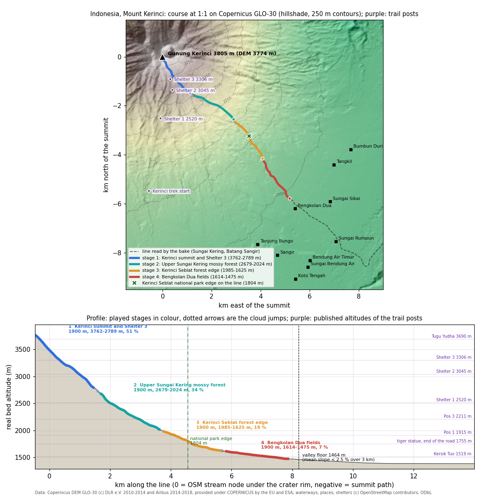

# Indonesia, Mount Kerinci

World id `indonesia`. Config `tools/bake/worlds/indonesia.json`, baked world `data/worlds/indonesia/`, test `test/bake-indonesia.test.mjs`. Researched and baked on 27/10/2026, reviewed the same day (see Review).

The image comes from `python3 tools/mountains/indonesia_profile.py`. It reads the baked world and the whole line from `tools/mountains/line.mjs`, offline. The trail posts (purple) are drawn to show where the water runs next to the climbers' route.

## The line and why

The spec offered Rinjani (Lombok) or Semeru (Java), or Kerinci (Sumatra) if it plays better. All three were read on the same Copernicus GLO-30 DEM with the bake's own functions (spine, bed profile, valley floor, stage choice), along every candidate line:

| Candidate | Line | Stage slopes (1.7 km windows) | Valley floor (first 3 km under 4 %) | Problem |
|---|---|---|---|---|
| Rinjani, south-east flank | DEM flow line (the `rinjani` world) | 47, 38, 22, 16 % | none before 350 m, near the coast | OSM has almost no stream up there; the flank never flattens |
| Rinjani, into Segara Anak | summit path to the lake, then Kokok Putih | 42, 37, 27, 18 % | 135 m, at the sea | 5.3 km grid path across the caldera; the lake is flat water |
| Semeru, Besuk Kobokan | OSM network (Kali Rejati, Sungai Regoyo) | 44, 54, 27, 12 % | 401 m, 17 km out | the lahar channel of the active crater (closed 13 km out, PVMBG); the floor is a wide lahar fan |
| Semeru, south-west flank | DEM flow line (the `semeru` world) | 54, 41, 21, 20 % | 568 m | generic DEM line, no named stream |
| Kerinci, north | OSM network (Batang Timbulun) | 43, 37, 27, 17 % | 665 m, 14.5 km out | long and steep, but the race ends in the jungle, far above any floor |
| **Kerinci, south-east** | **OSM network (Sungai Kering, Batang Sangir)** | **51, 38, 22 %, then the floor** | **1520 m at 7.1 km: the plateau of Kayu Aro and Gunung Tujuh** | **none** |

Kerinci south-east wins on four counts:

- **It is the steepest.** The mean slope from the summit to the floor is 30 %; the best Rinjani and Semeru lines average 16-21 %.
- **It ends on a real valley floor.** The plateau of Kayu Aro and Gunung Tujuh is where the slope drops below 2.5 % and stays there; Kersik Tuo, the village at the foot of the trail, is published at 1519 m. Rinjani and Semeru run down to the sea or a lahar fan, so their race stops where the line read ends.
- **The water line is real.** OSM maps the Sungai Kering from 400 m under the summit down to the fields, so `descent.kind` is `osm-network`, not a DEM guess.
- **Highest volcano of Indonesia, and the animals of the spec.** 3805 m, with the Sumatran tiger and the tapir of Kerinci Seblat National Park.

`rinjani` and `semeru` were archived on 27/10/2026 (one world per region): their configs are in `tools/bake/worlds/archive/`, no longer baked in `data/worlds/`.

Settings (`short` in the config):

| Setting | Value | Why |
|---|---|---|
| `floor` | slope 0.025, window 3000, after 3000 | the plateau below Bengkolan Dua runs at 0-2 %; at 4 % the floor came 1 km higher (1523 m) and left room for only 3 stages of 1.7 km |
| `stages` | 4 x 1900 m, gap 150, one per landmark | 4 x 1500 m gave 158 s and 4 x 1700 m under 180 s; 1900 m gives 194 s |
| `spine` | maxKm 14, sigma 40 | a stream in a narrow gully, finer than the Piave (35/60 is the default) |
| `iceAbove` | 99999 | no ice on Kerinci |
| `requireShortcut` | false | the gully has no bend wide enough for a shortcut; the bake puts a safe arm in the last stage |

## Course

The race lasts **194 s**: two bots in the real sim (183.7 s), plus 3.5 s of cloud for each of the 3 transitions (`data/worlds/index.json`). There are 4 stages of 1900 m, 7.6 km played in total.

| # | Stage (it / en) | km on the line | Bed altitude | Drop | Mean slope | Zones, branches |
|---|---|---|---|---|---|---|
| 1 | Vetta del Kerinci e Shelter 3 / Kerinci summit and Shelter 3 | -0.47-1.47 | 3762 → 2789 m | 973 m | 51 % | sun |
| 2 | Alto Sungai Kering, foresta di muschi / Upper Sungai Kering mossy forest | 1.70-3.61 | 2679 → 2024 m | 655 m | 34 % | rain |
| 3 | Margine della foresta di Kerinci Seblat / Kerinci Seblat forest edge | 3.76-5.68 | 1985 → 1625 m | 360 m | 19 % | none |
| 4 | Campi di Bengkolan Dua / Bengkolan Dua fields | 5.83-7.86 | 1614 → 1475 m | 139 m | 7 % | safe arm, 4 rocks |

- **Km 0** is the OSM stream node under the south-east crater rim (-1.7011, 101.2659). The first 470 m are the summit path from the DEM top to the stream.
- **Cloud jumps:** 230 m, 150 m and 150 m along the line. The stages are almost continuous, and each starts 100-110 m below where the last one ended.
- **Finish:** 1475 m, 725 m from Bengkolan Dua. The index calls it "Campi di Bengkolan Dua" / "Bengkolan Dua fields" (`finish.names`). Bengkolan Dua is a desa of Kecamatan Gunung Tujuh, which was split from Kecamatan Kayu Aro in 2006 (id.wikipedia), so the name no longer carries "Kayu Aro".
- **Valley floor:** km 8.21, 1464 m. From there the stream joins the Batang Sangir across the flat plateau of Gunung Tujuh (1380-1460 m for 6 km; Bumbun Duri 1460 m, Tangkil 1394 m, kodepos.co.id).
- **Stage 1 passes Shelter 3:** 164 m from the OSM node of the shelter, at 3220 m in the gully. The test checks it.
- **The national park ends inside stage 3.** The boundary of Taman Nasional Kerinci Seblat (OSM relation 8465254) crosses the line at km 4.56, 1804 m, the same height as Pintu Rimba, the forest gate of the trail (about 1800 m). Stages 1 and 2 and the top 40 % of stage 3 are park; the rest of stage 3 and all of stage 4 are farms. That is why stage 3 is the "forest edge" and the forest species spawn only above 1800 m.
- **Land cover** (ESA WorldCover 2021, 10 m, within 300 m of the line): stage 1 is bare ash and scree down to about 3200 m (79 % bare in its upper half) and forest below 3150 m (82 % tree in its lower half), so the `volcanic` biome fits only the top half; stage 2 is 100 % tree; stage 3 goes from 73 % to 46 % tree, with crops below the park edge; stage 4 is 61-70 % crop and grass, with tree strips along the stream (cinnamon gardens and riparian trees). OSM farmland touches the course 131 m away at 1563 m. On the trail side the fields reach 1755 m (gunungbagging).

## Places and published altitudes

Trail altitudes differ between guides by up to 50 m. The table gives gunungbagging.com first and the others in brackets.

| Place (en / it / local) | Published | DEM under the course | Where |
|---|---|---|---|
| Mount Kerinci / Monte Kerinci / Gunung Kerinci, summit Puncak Indrapura | 3805 m (Wikipedia, id.wikipedia) | 3774 m (the 30 m DEM shaves the cone) | start of stage 1 |
| Tugu Yudha memorial / Tugu Yudha / Tugu Yudha | 3690 m | | on the summit ridge, west of the course |
| Shelter 3 / Shelter 3 / Shelter 3 | 3306 m (3291, 3350; OSM node 3300) | 3220 m, 164 m from the course | stage 1 |
| Shelter 2 / Shelter 2 / Shelter 2 | 3045 m (3056, 3100) | 3105 m, 392 m from the course | stage 1 |
| Shelter 1 / Shelter 1 / Shelter 1 | 2520 m (2505) | the course is 1.5 km east, at the end of stage 1 | west of stages 1-2 |
| Pos 3 Pondok Panorama / Pos 3 / Pos 3 Pondok Panorama | 2211 m (2225) | on the trail, west | next to stage 2 |
| Pos 2 Batu Lumut / Pos 2 / Pos 2 Batu Lumut | 2020 m (2010) | on the trail, west | next to stage 2-3 |
| Pos 1 Bangku Panjang / Pos 1 / Pos 1 Bangku Panjang | 1915 m (1889) | on the trail, west | next to stage 3 |
| Pintu Rimba (forest gate) / Pintu Rimba / Pintu Rimba | about 1800 m (1809) | the course crosses 1800 m in stage 3 | stage 3 band |
| Tiger statue at the end of the road, "beside fields of chillis and potatoes" | 1755 m | | where the fields meet the forest on the trail side |
| Kersik Tuo / Kersik Tuo / Kersik Tuo (also Kersik Tua) | 1519 m ("about 1600 m" in other guides) | floor 1464 m, finish 1475 m | 4.2 km south-west of the finish |
| Bengkolan Dua / Bengkolan Dua / Bengkolan Dua (also Bengkolan Duo), desa of Kecamatan Gunung Tujuh | 1586 m at -1.7431, 101.3015 (kodepos.co.id), 352 m from stage 4 | 1579 m at that point | the OSM node is 725 m from the finish, 144 m from the line at km 8.3, just past the floor |
| Kayu Aro / Kayu Aro / Kayu Aro (kecamatan around Kersik Tuo, and the tea estate) | plateau 1400-1600 m | | west and south-west of the line; until 2006 also the district of Bengkolan Dua |
| Gunung Tujuh / Gunung Tujuh / Gunung Tujuh (kecamatan, seat Pelompek) | Bumbun Duri 1460 m, Tangkil 1394 m (kodepos.co.id) | 1380-1460 m | stage 4 and the plateau below the floor |
| Taman Nasional Kerinci Seblat boundary | | 1804 m on the line (OSM relation 8465254) | km 4.56, in stage 3 |
| Batang Sangir / Batang Sangir / Batang Sangir | | | the river the Sungai Kering joins on the plateau |

Notes:
- The villages in `world.json` come from OSM via Overpass (`data/raw/osm/indonesia/places.json`). The bake keeps only nodes with a `place` tag, so the shelters, the trail start and Pintu Rimba appear only here and in the image.
- The OSM "Kerinci Trek Start" node is at -1.7470, 101.2594.
- The famous Kayu Aro tea gardens lie around Kersik Tuo, west of the line. The finish fields are the vegetable farmland east of them (OSM `landuse=farmland`), so the stage is named after Bengkolan Dua and not after the tea.
- Local names are Indonesian; the Latin script needs no `name:en` (`osm.nameTags: ["name"]`).

## Fauna by altitude band

Only species of Kerinci Seblat, each spawned inside its real band. Forest species are cut at the national park edge (1800 m), because the line runs through farms below it; only the tiger and the hornbill in flight reach the fields.

| Species (en / it) | Config kind | Band in the game | Real range, source | Stages |
|---|---|---|---|---|
| Sumatran tiger / tigre di Sumatra (*Panthera tigris sumatrae*), CR | `sumatran-tiger` | 0-3200 m, one per stage | sea level to 3200 m in mountain forest (the 3200 m record is from Gunung Leuser); Kerinci Seblat holds the largest population (Wikipedia; FFI/WildCats reports, 128 tigers in 2020); tigers come out to the farms of Kayu Aro (BBTNKS checks, Metro TV) | 1, 2, 3, 4 |
| Malayan tapir / tapiro malese (*Tapirus indicus*), EN | `malayan-tapir` | 1800-2020 m | in Sumatra up to 1500 m, possibly 2000 m when crossing a ridge (Handbook of the Mammals of the World via Plazi); tracks up to 2020 m in the Gunung Tujuh forest of the park, next to this line (Farida et al. 2006, Biosfera); photo-trapped in Kerinci Seblat (Holden, Yanuar and Martyr 2003, Oryx 37: 34-40) | 3 |
| Sumatran striped rabbit / coniglio striato di Sumatra (*Nesolagus netscheri*), VU | `sumatran-striped-rabbit` | 1800-2300 m, one per stage | usually 600-1600 m (EDGE), camera-trapped at 2300 m in Kerinci Seblat in 1997 | 2 |
| Salvadori's pheasant / fagiano di Salvadori (*Lophura inornata*), NT, Sumatran endemic | `salvadoris-pheasant` | 1800-2200 m, one per stage | montane forest about 600-2200 m, mostly above 800 m, prefers primary forest; recent records on Gunung Kerinci (BirdLife datazone) | 2, 3 |
| Wreathed hornbill / bucero ondulato (*Rhyticeros undulatus*), VU, in flight | `wreathed-hornbill` | 0-2560 m, one per stage, `bird: true` (the bake writes `flying: true` only for `eagle`, so the game must know the hornbill flies) | recorded to 2560 m (Wikipedia); sound recording on Mount Kerinci at 2100 m (xeno-canto) | 2, 3, 4 |

Left out:
- **The summit cone (3200-3800 m) has no animal.** It is bare ash and scree above the vegetation line near Shelter 3 (id.wikipedia; "no more vegetation" at Shelter 3, detik). Only the lowest part of stage 1 gets a tiger.
- **No orangutan.** Neither species lives this far south.
- **No siamang** (removed in review). It lives in Kerinci Seblat, but mostly at 300-1500 m and at most 1829 m (Primate Info Net). On this line the park ends at 1804 m: above is montane forest past its range, below are farms. The earlier bake put it at 1650 m in the fields below the park.
- **No Sumatran serow.** It lives in Kerinci Seblat, but no source found gives it on Kerinci's slopes or a band to use.
- **Not spawned (no source places them on this line):** Schneider's pitta (900-2400 m), sun bear and muntjac.

## Models in the game

`src/render/animals/species-asia.js` builds each species at load time from a free Poly by Google model (CC-BY 3.0, credited in `assets/CREDITS.md`), reshaped, repainted and smoothed in code; the lineup is `docs/screens/animals-indonesia.png`.

| Species | Built from | What makes it the species |
|---|---|---|
| Sumatran tiger | "Tiger", [poly.pizza/m/5A3w06FXUup](https://poly.pizza/m/5A3w06FXUup) | the darkest orange of the tigers, close narrow stripes, white cheek ruff, throat and belly, ringed tail with a black tip |
| Malayan tapir | "Collared peccary", [poly.pizza/m/3eoOcw_d00X](https://poly.pizza/m/3eoOcw_d00X) | lower, barrel body, the rump the highest point, short drooping proboscis, white-rimmed round ears; black with the white saddle from behind the shoulders to the rump, black hind legs |
| Sumatran striped rabbit | "Rabbit", [poly.pizza/m/9OBTRVYUSmt](https://poly.pizza/m/9OBTRVYUSmt) | short ears; grey-buff with the dark stripes along the spine, over the shoulder, along the flank, round the haunch and through the eye; rufous rump |
| Salvadori's pheasant | "Pheasant", [poly.pizza/m/1wqLCnNFCgv](https://poly.pizza/m/1wqLCnNFCgv) | the long ring-necked tail cut to the short, broad, arched *Lophura* tail; the male's blue-black plumage with a blue sheen, bare red face, pale bill |
| Wreathed hornbill (in flight) | "Bird", [poly.pizza/m/8Ph79kHbt9s](https://poly.pizza/m/8Ph79kHbt9s), the golden eagle's model | the raptor's bill replaced by the long pale bill with its low casque and the yellow throat pouch, neck stretched out; black with a white tail, the male's cream head and neck, chestnut crown |

The ground hornbill on Poly Pizza (perched) was not used: a wreathed hornbill is seen flying over the canopy, and only the soaring body could carry it.

## Free 3D models per species (research)

Rules: CC0 or CC-BY only (spec).

- **Poly Pizza** downloads without a login. Poly by Google models there are CC-BY 3.0. All 11 Poly Pizza links below were re-checked in review (title, author and licence on the page): "Rabbit" by Quaternius is CC0 1.0, all the others are CC-BY 3.0. The 9 Sketchfab links were checked through the Sketchfab API: all "CC Attribution" and downloadable. The game already uses Poly by Google models (`assets/CREDITS.md`).
- **Sketchfab** needs a login to download, so those models are second choices.
- **Quaternius:** the Poly Pizza searches for tiger, tapir, gibbon and hornbill return no Quaternius model of these species, only rabbits. **Kenney**'s animals are cube characters.

"No smooth direct model" means that no free model of the species exists, so it has to be made from a model of the same shape, as the spec says.

| Species | Best candidate | Alternatives | Smooth direct model? |
|---|---|---|---|
| Sumatran tiger | "Tiger", Poly by Google, CC-BY 3.0, https://poly.pizza/m/5A3w06FXUup (low poly, static): repaint darker orange, narrow close stripes, white cheek ruff | "Tiger", jeremy, CC-BY 3.0, https://poly.pizza/m/54KLm0HdFWy; "Tiger", moizmuhammad373, CC-BY, 4650 faces, 7 animations, https://sketchfab.com/3d-models/67bbedd727a047869ef7c7b608445484; "Running Tiger", francescolima74, CC-BY, 4650 faces, animated, https://sketchfab.com/3d-models/fc2c7fd74dd04e39935803b884c77258; "White Tiger (rigged, animated)", MotionStreamStudios, CC-BY, 33k faces, https://sketchfab.com/3d-models/9dd099d283e54f99b7cbd40b531b1a29. "Sumatran Tiger" by jeremielouvetz is CC-BY-NC: excluded. The moizmuhammad373 and francescolima74 tigers have the same 4650 faces: one is probably a re-upload of the other, so check the original author before crediting either | yes (Sketchfab, animated); on Poly Pizza only faceted |
| Malayan tapir | "Tapir", planeta-elefante, CC-BY, 1756 faces, 6 animations, https://sketchfab.com/3d-models/8b6e79f84f98456484fb38fe164340d1: repaint the white saddle | "Malayan Tapir", jo_shu, CC-BY, 387k faces (needs decimation), https://sketchfab.com/3d-models/9d3dceacac064c06b8c4f92192f783cb; from Poly Pizza, "Collared peccary", Poly by Google, CC-BY 3.0, https://poly.pizza/m/3eoOcw_d00X, reshaped (longer body, short proboscis, rounded rump, black and white). "Malayan Tapir Voxel" is boxy; "Tapir (non commercial)" is NC | no tapir on Poly Pizza; on Sketchfab, yes |
| Sumatran striped rabbit | "Cottontail rabbit", Poly by Google, CC-BY 3.0, https://poly.pizza/m/3vvONbRCuEF: short ears like the real one; paint buff-grey with dark brown stripes and a rufous rump | "Rabbit", Quaternius, CC0, https://poly.pizza/m/mKev485XTR (a plush character: check the proportions); "Jackrabbit", Poly by Google (already in the game as the mountain hare) | **no**: no striped rabbit model; repaint a rabbit |
| Salvadori's pheasant | "Pheasant", Poly by Google, CC-BY 3.0, https://poly.pizza/m/1wqLCnNFCgv (ring-necked): shorten the tail, blue-black male with a red face, chestnut female | "Ring Necked Pheasant", warrenblyth, CC-BY, 844 faces, animated, https://sketchfab.com/3d-models/f6d8887011314469b55f03a5807705db; "Quail", Poly by Google, CC-BY 3.0, https://poly.pizza/m/4A0kLzM65Mg | **no**: no Lophura model; repaint a galliform |
| Wreathed hornbill (in flight) | "Rhinoceros hornbill", giunjay, CC-BY, 3610 faces, animated, https://sketchfab.com/3d-models/935d000754a74fd38796d7628696f943: reshape the casque into the low ridged one, add the yellow barred throat pouch, white tail | "Abyssinian ground hornbill", Poly by Google, CC-BY 3.0, https://poly.pizza/m/6oDRcPLTN9R (perched shape, beak and casque to transplant); "Bird", Poly by Google, CC-BY 3.0, https://poly.pizza/m/8Ph79kHbt9s (the soaring body the game already uses for the eagle); "Hornbill Bird", aniljaco, CC-BY, 50k faces, https://sketchfab.com/3d-models/84d30aab1a824a0fa0ce3e4e35402da4 | close: a rhinoceros hornbill is the nearest free model; no wreathed hornbill |

## Look in the game

`src/render/themes/indonesia.js`, checked by `test/render-indonesia.test.mjs`; renders in `docs/screens/world-indonesia-s0.png` to `-s3.png` and `-hero.png`.

| Visible element | In the game | Source |
|---|---|---|
| Vegetation bands | forest 1750-2950 m, ericaceous scrub 2950-3250 m, bare above | Ohsawa, Nainggolan, Tanaka and Anwar 1985, J. Trop. Ecol. 1: 193-216, nine plots on this mountain: natural forest from 1750 m to the forest limit at 2950 m, scrub to the upper limit of vegetation at 3250 m. WorldCover's tree class reaches 3150 m because it counts the tall scrub as tree |
| Summit cone, stage 1 | grey-brown ash and scoria, dark andesite on the steep ground, no snow, no ice | Wikimedia Commons photos of the summit path ("Jalur Turun Gunung Kerinci", "SummitOfMountKerinci", "Track Menuju Top Gunung Kerinci"); en.wikipedia (active stratovolcano, no glacier) |
| Scrub, stage 1 | low yellow-green and olive mounds on dark ash | Ohsawa 1985 (scrub zone); Commons "Tanaman Khas Di Gunung Kerinci Yang Unik" (a yellow-green bush on the ash of the upper slope); cantigi (Vaccinium varingiifolium) is the common scrub of Sumatran and Javan summits |
| Montane forest, stages 2-3 | closed broadleaf canopy: tall round crowns to about 2450 m, low mossy olive crowns above, an understory of saplings, tree ferns | Ohsawa 1985 (lower forests with solitary giants, upper ones lower and poorer); Commons "Jalur pendakian shelter 1", "Jurang batu lumut", "Pintu Rimba" (dense forest, ferns, mossy trunks) |
| No conifer shapes | none | the Kerinci forest is broadleaf (Fagaceae, Lauraceae, Ericaceae); podocarps occur but do not look like spruce, so none is drawn |
| Park edge, stage 3 | the canopy opens to fields at about 1800 m | OSM relation 8465254 (park boundary at 1804 m on the line) |
| Fields, stage 4 | plots of potatoes, chillies, cabbages, leeks and tilled dark earth, copses of cinnamon, trees along the stream | gunungbagging ("fields of chillis and potatoes" at the trail head), ESA WorldCover (61-70 % crop), Cinnamomum burmannii, the Korintje (Kerinci) cassia (en.wikipedia) |
| No tea | none on the line | the Kayu Aro estate lies west of the line (see Places) |
| Stream | clear, a little tea-green over dark volcanic sand, grey andesite boulders | Commons "Sumber air batu lumut", "Jurang batu lumut" (clear water over grey boulders); not glacial |
| Banks | dark brown andosol | the same photos; volcanic soils of the Kerinci slopes |
| View painting | Lake Kerinci and the Kerinci valley, turned 8 deg so the lake sits at its real bearing (about 158 deg from the line) | assets/backdrops/CREDITS.md; lake centre -2.15, 101.45 |
| Animals | tiger, tapir, striped rabbit, Salvadori's pheasant, wreathed hornbill in their bands | Fauna by altitude band, above |

## Commands

| Command | What it does |
|---|---|
| `node tools/bake/index.mjs indonesia` | bakes the world (2-4 s with `data/raw/osm/indonesia/` and the DEM tile `S02_E101` on disk; `--offline` touches no network) and refreshes `data/worlds/index.json` |
| `python3 tools/mountains/indonesia_profile.py` | redraws `docs/mountains/indonesia-profile.png` |
| `node --test test/bake-indonesia.test.mjs` | published altitudes, stage order and slope, park edge and animal bands, two sim bots, determinism |

## Sources

| Fact | Source |
|---|---|
| National park boundary on the line | OpenStreetMap relation 8465254 (Taman Nasional Kerinci Seblat), read through Overpass on 27/10/2026 |
| Land cover along the course | ESA WorldCover 10 m 2021 v200, tile S03E099, (c) ESA WorldCover project 2021, CC-BY 4.0, https://esa-worldcover.org |
| Bengkolan Dua in Kecamatan Gunung Tujuh (split from Kayu Aro in 2006); village coordinates and altitudes | https://id.wikipedia.org/wiki/Gunung_Tujuh,_Kerinci; https://www.kodepos.co.id/kodepos/jambi/kabupaten-kerinci/gunung-tujuh |
| Tapir tracks up to 2020 m in the Gunung Tujuh forest | Farida, Wirdateti, Dahruddin and Sumaatmadja 2006, Biosfera (Unsoed), https://journal.bio.unsoed.ac.id/index.php/biosfera/article/download/163/122 |
| Tigers at the farms of Kayu Aro | https://www.metrotvnews.com/read/b2lC6WAO-kemunculan-harimau-di-kerinci-warga-diimbau-tidak-berladang-sendirian; https://www.jpnn.com/news/bksda-telusuri-informasi-kemunculan-harimau-di-kerinci |
| Elevation 3805 m, coordinates, crater, vegetation | https://en.wikipedia.org/wiki/Mount_Kerinci |
| Puncak Indrapura, vegetation line near 3291 m, fauna list | https://id.wikipedia.org/wiki/Gunung_Kerinci |
| Kersik Tuo 1519 m, tiger statue 1755 m among chilli and potato fields, Pos 1-3, Shelter 1-3, Tugu Yudha 3690 m | https://www.gunungbagging.com/kerinci |
| Pos 1 1889 m, Pos 2 2010 m, Pos 3 2225 m, Shelter 1 2505 m, Shelter 2 3100 m, Shelter 3 3350 m, Puncak Indrapura | https://www.detik.com/sumbagsel/wisata/d-6765375/catatan-perjalanan-menapaki-gunung-kerinci-gunung-tertinggi-di-sumatera/amp |
| Pintu Rimba 1809 m, Shelter 2 3056 m, Shelter 3 3291 m | Indonesian trip reports found by web search on 27/10/2026 (one source each; treat as approximate) |
| Tiger range to 3200 m, Kerinci Seblat population | https://en.wikipedia.org/wiki/Sumatran_tiger; https://conservewildcats.org/portfolio/indonesia/ |
| Tapir altitude in Sumatra | https://tb.plazi.org/GgServer/html/039CED53FFC4FF88FA5021E814549604 (Handbook of the Mammals of the World); Holden and Yanuar 2003, https://rhinoresourcecenter.com/library/references/the-asian-tapir-in-kerinci-seblat-national-park-sumatra-evidence-collected-through-photo-trapping/ |
| Siamang altitude | https://primate.wisc.edu/primate-info-net/pin-factsheets/pin-factsheet-siamang/ |
| Sumatran striped rabbit | https://www.edgeofexistence.org/blog/species-of-the-week-sumatran-striped-rabbit/; https://treatment.plazi.org/GgServer/html/03822308B741FFFFFFCFF3F0F952FCB2 |
| Salvadori's pheasant | https://datazone.birdlife.org/species/factsheet/salvadoris-pheasant-lophura-inornata/text |
| Wreathed hornbill | https://en.wikipedia.org/wiki/Wreathed_hornbill; https://www.xeno-canto.org/species/Rhyticeros-undulatus |
| Schneider's pitta 900-2400 m | https://en.wikipedia.org/wiki/Schneider%27s_pitta |
| Semeru, Besuk Kobokan exclusion zone | https://rri.co.id/en/archipelago/2510098/mount-semeru-erupts-twice-on-monday-morning-sending-ash-up-to-1000-meters |
| Elevation data | Copernicus DEM GLO-30, (c) DLR e.V. 2010-2014 and (c) Airbus Defence and Space GmbH 2014-2018, provided under COPERNICUS by the European Union and ESA |
| Streams, villages, shelters, farmland | (c) OpenStreetMap contributors, ODbL |

## Review

Independent review on 27/10/2026. What was checked:

- **Summit:** 3805 m and 1°41'48"S 101°15'56"E (en.wikipedia) match the config; the DEM top is 150 m from those coordinates, at 3774 m.
- **The line is in the gully:** DEM cross-sections at ±60 and ±120 m along every stage show the bed lower than both banks from 3580 m down (higher sides by 5-60 m in stages 1-2, 0-30 m in stages 3-4). The first 200 m are the summit path down the cone, as documented.
- **No ice:** Kerinci has no glacier; WorldCover has no snow class on the course.
- **Valley floor:** the slope falls under 2.5 % at 1464 m and the plateau stays at 1380-1460 m for 6 km (DEM and village altitudes). No plain is played: the gentlest stage, 4, still drops 7 %.
- **Stages and time:** 4 x 1900 m, 7.6 km, 183.6 s for two bots in the sim plus 3 cloud jumps, 194 s.
- **Licences:** every model link, as noted above.

What changed:

- **Park edge.** The doc said stages 1-3 were all national park forest. The OSM boundary crosses the line at 1804 m, inside stage 3, and the old bake put the tapir (1691 m) and the siamang (1650 m) in the farms below it. The tapir, striped rabbit and Salvadori's pheasant now start at 1800 m. The test checks that they spawn only above the edge, that stage 3 crosses it, that stage 4 lies entirely below it, and that the fields hold only the tiger and the hornbill.
- **Siamang removed**, as above. Species order in the config was set so that the bake's spawn rotation still places every species (the tapir in stage 3).
- **Names.** Bengkolan Dua is in Kecamatan Gunung Tujuh, not Kayu Aro: stage 4 is now "Campi di Bengkolan Dua" / "Bengkolan Dua fields" (id `bengkolan-dua`). Stage 3 is "Margine della foresta di Kerinci Seblat" / "Kerinci Seblat forest edge". The spelling "Bengkolan Dua" is the id.wikipedia one; kodepos.co.id writes "Bengkolan Duo".
- **Image:** the park edge is marked on the map and the profile.

