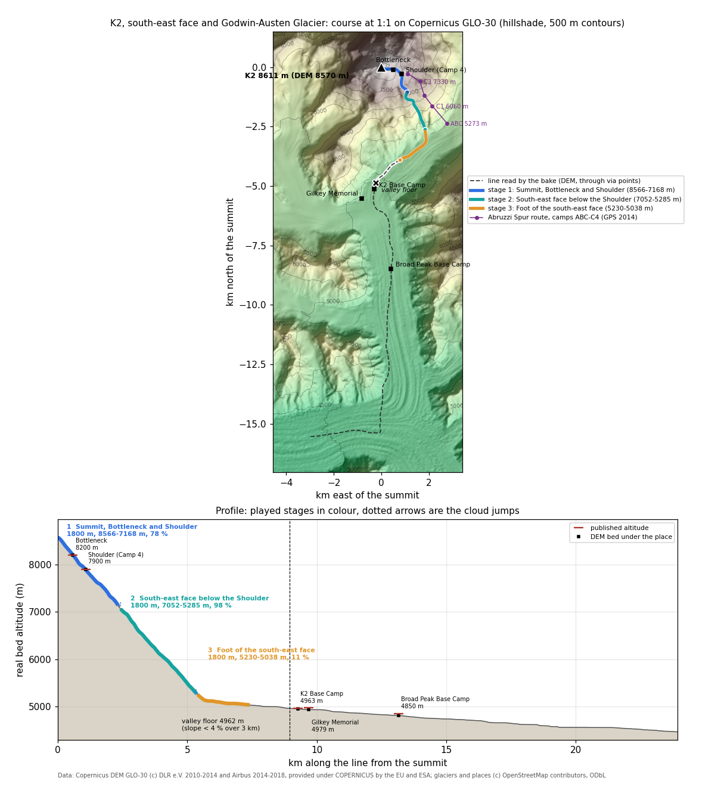

# K2, south-east face and Godwin-Austen Glacier

World id `k2`. Config `tools/bake/worlds/k2.json`, baked world `data/worlds/k2/`, test `test/bake-k2.test.mjs`. Researched and baked on 27/10/2026; line on the face corrected and rebaked after review the same day; at night the race was cut to the steep part, ending at the foot of the face (see "Floor settings").



The image comes from `python3 tools/mountains/k2_profile.py`. It reads the baked world and the whole line from `tools/mountains/line.mjs`, offline. On the map, the purple line is the Abruzzi Spur route through the camps measured by GPS in 2014. In the profile, red ticks are published altitudes and black squares the DEM bed under each place.

## The line and why

K2 stands on the Pakistan (Gilgit-Baltistan) and China (Xinjiang) border, in the Karakoram, not in Nepal. The Pakistan side drains south into the **Godwin-Austen Glacier**, which meets the Baltoro at **Concordia**. That is the side of the brief, and the side every trek and the Abruzzi route use.

A drop on the summit runs down the summit snowfield and the **Bottleneck** couloir (about 8200 m) onto the **Shoulder** (Camp 4, 7750-7950 m). The climbers' route then follows the **Abruzzi Spur**, the south-east ridge, through camps 3, 2 and 1 to the Advanced Base Camp. Water does not run along a ridge, so the course leaves the route at the Shoulder and takes the **steepest-descent line of the DEM**: the couloir of the south-east face west of the spur. The Abruzzi camps 1-3 stay 520-670 m east of the course. The couloir drops about 2750 m in 3 km and reaches the upper Godwin-Austen basin at about 5100 m, 1.2 km south-west of the Advanced Base Camp.

From the foot of the face the line follows the ice:
- past **K2 Base Camp** and the **Gilkey Memorial**;
- down the Godwin-Austen Glacier under **Broad Peak Base Camp**;
- to **Concordia**, where the Godwin-Austen meets the Baltoro.

Real meltwater on this glacier runs on and under the ice and leaves it only at the Baltoro snout, 60 km further on and 1000 m lower. From the foot of the face that is all gentle ice (3-5 % to Concordia, then the long Baltoro tongue), so the race stops at the foot of the face, on the upper Godwin-Austen just above K2 Base Camp. The rest of the line is the backdrop and the place list.

**Why the line comes from the DEM.** OSM maps no stream on the face or on the glacier. The line is a least-cost downhill path on the Copernicus GLO-30 DEM (`descent.kind: dem`) through 25 via points: the Bottleneck and the Shoulder, 13 points of the steepest-descent trace from the Shoulder down the couloir, and 10 on the glacier's centre. It ends 5 km down the Baltoro (`descent.to`), so the floor search has ice beyond Concordia to read.

**Review fix (27/10/2026).** The first bake put the face points along longitude 76.524. The DEM shows that this is the east flank of a rib: the line crossed a divide near 6700 m and ran 300-760 m west of where water from the Shoulder actually goes (steepest descent on a 3x3 mean at 30 m, 20 m steps). The 13 face points now come from that trace. The south-east-face stage stays within 95 m of it, and the test fails beyond 150 m. With the real couloir the face is exactly two stages long, and with a 300 m gap between stages the third stage was left on the flat basin at 6 %. A 150 m gap, as on `indonesia`, puts it on the foot of the face at 14 %.

**Floor settings.** `floor.after: 5000` stops the floor search from firing on the Shoulder, which is almost level for a few hundred metres. `slope: 0.04` over `window: 3000` finds the first 3 km under 4 %: they start at km 8.9, 4962 m on the DEM bed, which is K2 Base Camp (4963 m by GPS in 2014). Until 27/10/2026 the slope was 0.02, which put the floor at Concordia and let a fourth stage run 1.7 km of the Godwin-Austen at 5 % (4930 → 4845 m), a glacier plain that the spec does not play ("se è pressoché pianeggiante non è più divertente"). Now three stages of 1800 m, 100 m apart, fill the steep part: the third runs from the lowest face onto the glacier.

**Ice.** Every stage is on ice. OSM glacier outlines name the Godwin-Austen Glacier (OSM spells it "Godwin Austen Glacier") on stage 3. Unnamed outlines cover the summit (`way/687600698`) and the face (`way/687602327`). No outline here carries an icefall tag.

## Course

The race lasts **138 s**: two bots in the real sim take 130.9 s, plus 3.5 s of cloud for each of the 2 transitions (`data/worlds/index.json`). There are 3 stages of 1800 m each, 5.4 km played. It is the one world under 3 minutes: at 1:1 only about 5 km of the line are steep (`test/bake-k2.test.mjs` holds it to about 2.2-5 minutes, 130-300 s). Until 28/10/2026 it was 157 s: every landing put the drop down level, so the next step launched it again off the 78-98 % face and the bots spent 60 % of the face stage in the air; the landing relaunch fix of 28/10/2026 (the drop lands following the slope) removed those false flights.

| # | Stage (it / en) | km on the line | Bed altitude | Drop | Mean slope | Zones and biome |
|---|---|---|---|---|---|---|
| 1 | Vetta, Collo di bottiglia e Spalla / Summit, Bottleneck and Shoulder | 0.00-2.30 | 8566 → 7168 m | 1398 m | 78 % | ice; `highAlpine` |
| 2 | Parete sud-est sotto la Spalla / South-east face below the Shoulder | 2.45-5.34 | 7052 → 5285 m | 1767 m | 98 % | ice; `icefall` |
| 3 | Piede della parete sud-est / Foot of the south-east face | 5.45-7.36 | 5230 → 5038 m | 192 m | 11 % | ice, Godwin Austen Glacier; `icefall`; one safe arm, 4 obstacles |

Notes on the course:
- **km on the line** is measured along the line the bake reads. A stage is 1800 m along the course in plan, which is shorter than the km span on the steep stages.
- **Cloud jumps:** 100 m in plan from stage 1 to 2 (117 m lower) and 100 m from 2 to 3 (55 m lower).
- **Finish:** 5038 m on the Godwin-Austen at the foot of the face, 1.9 km up the glacier from K2 Base Camp. The index calls it "Ghiacciaio Godwin-Austen ai piedi del K2" / "Godwin-Austen Glacier at the foot of K2" (`finish.names`); the world is "K2, parete sud-est e Godwin-Austen" / "K2, south-east face and Godwin-Austen" (it no longer reaches the Baltoro).
- **Valley floor:** km 8.9, 4962 m, K2 Base Camp.
- **Headings** (`stage.heading`, for the painted backdrop): 133.8, 152.1 and 222 degrees, south-east down the face, then south-west where the Godwin-Austen turns towards Concordia.

## Places and published altitudes

The most precise source is the 2014 high-precision GPS survey of the summit and the Abruzzi camps (Ev-K2-CNR and University of Trieste, Leica Viva GS14; [montagna.tv, "Quanto è alto il K2?"](https://www.montagna.tv/wp-content/uploads/2014/10/Nota-misurazione-K2-pagine-per-web-ita.pdf)). Its heights are on the geoid.

| Place (en / it / local) | Published | DEM bed under the line | Where |
|---|---|---|---|
| K2 / K2 / Chogori (said to be Balti for "big mountain", little used locally); Ketu or Kechu (Balti کے چو); Urdu کے ٹو; Chinese 乔戈里峰 Qogir (Qiáogēlǐ Fēng) ([Wikipedia](https://en.wikipedia.org/wiki/K2)) | 8611 m official; 8609 m by GPS in 2014, at 35.88146 N, 76.51325 E | 8570 m, the highest cell, 99 m south-west of the GPS summit (the 30 m DEM shaves the summit) | start of stage 1 |
| Bottleneck / Collo di bottiglia | about 8200 m, 400 m below the summit ([Cranfield, Climbing K2](https://www.som.cranfield.ac.uk/som/som_applications/k2/climbing.htm)) | 8204 m | stage 1, km 0.59 |
| Shoulder, Camp 4 / Spalla, campo 4 | Camp 4 at 7747 m by GPS in 2014 (35.87829 N, 76.52493 E); about 7950 m in other seasons ([ExplorersWeb](https://explorersweb.com/k2-the-nepali-force-ties-winter-altitude-record/)); the Shoulder begins at 7689 m ([Cranfield](https://www.som.cranfield.ac.uk/som/som_applications/k2/climbing.htm)) | 7891 m, at the config point 270 m west of the 2014 Camp 4 | stage 1, km 1.08 |
| Abruzzi Spur camps 3, 2, 1 / campi 3, 2, 1 dello Sperone Abruzzi | 7330, 6654 and 6060 m by GPS in 2014 | 520-670 m east of the course (test: at least 400 m) | beside stage 2 |
| Advanced Base Camp / Campo base avanzato | 5273 m by GPS in 2014 (35.85952 N, 76.54315 E); 5300 m (ExplorersWeb) | the course reaches the glacier 1.2 km south-west of it, at about 5100 m | beside stage 3 |
| K2 Base Camp / Campo base del K2 | 4963 m by GPS in 2014 (35.83480 N, 76.50933 E); 4965 m in OSM (node 4844636351); 5000-5150 m in trekking guides | 4953 m | cloud jump 3 → 4, km 9.27 |
| Gilkey Memorial / Memoriale Gilkey | 4979 m by GPS in 2014 (35.83055 N, 76.50298 E; OSM node 5846660589) | 4936 m, 0.5 km off the line | cloud jump 3 → 4 |
| Broad Peak Base Camp / Campo base del Broad Peak | 4823 m in OSM (node 4844644047); 4650-4850 m in trekking guides ([Geographica, Baltoro trek](https://www.geographica.es/uploads/viajes/v5268-trekking-del-baltoro.pdf)) | 4814 m | below the finish, km 13.15 |
| Concordia / Concordia / Chinese 肯考迪亚 (OSM) | 4691 m at 35.733 N, 76.517 E, to the arc minute ([Wikipedia](https://en.wikipedia.org/wiki/Concordia_(Karakoram))); 4600 m (OSM `ele`, node 1407583985, 35.7416 N, 76.5119 E); 4550 m in some trek notes | 4559 m | 1.7 km below the floor, not played |

Notes:
- **Where the places come from.** Overpass returned one place in the box, the Concordia `locality` node (`data/raw/osm/k2/places.json`). The base camps are `tourism=camp_site` nodes without a `place` tag, so the query does not pick them up. The bake therefore uses `placesFallback`. Its coordinates match the OSM nodes exactly and the 2014 GPS points to within 70 m. `world.json` labels the source "approximate coordinates from the bake config (Overpass unavailable)". That label comes from shared bake code and is slightly wrong here: Overpass did answer, it just returned only Concordia.
- **Published altitudes disagree.** Base camps move from season to season and sit on moving ice, and sources differ by 100-300 m. The test uses ranges, not a single value.
- **What the test checks:**
  - the DEM summit is within 60 m of 8611 m;
  - the Bottleneck and the Shoulder are in stage 1, within 150 m of 8200 and 7900 m;
  - below the Shoulder, the south-east-face stage stays within 150 m of the DEM steepest-descent line, and the Abruzzi camps 1-3 stay at least 400 m from the course;
  - the finish lies between K2 Base Camp and Broad Peak Base Camp, on the Godwin Austen Glacier ice;
  - the floor is between 4540 and 4691 m, within 2.5 km of Concordia;
  - the places are in order down the line.

## Fauna by altitude

These are the bands in `animals.kinds`. A spawn has to fall inside its band (bake check, ±150 m). `test/bake-k2.test.mjs` also keeps mammals off the upper face (below 5650 m only).

The main source is the Central Karakoram National Park (CKNP, 10,557 km², founded 1993), which includes K2, the Baltoro and Concordia ([Wikipedia](https://en.wikipedia.org/wiki/Central_Karakoram_National_Park); [Gilgit-Baltistan Forest, Wildlife & Environment Dept.](https://fwegb.gov.pk/cknp/); [CKNP wildlife guide](https://www.cknp.org/karakoram-wildlife-guide/)).

| Species | Band | Real range and source | Where it can appear |
|---|---|---|---|
| Siberian (Himalayan) ibex (*Capra sibirica*) | 3000-5000 m | herds of 10-80 animals on high slopes all over CKNP, 3000-5000 m ([CKNP guide](https://www.cknp.org/karakoram-wildlife-guide/)); 2000-5000 m in summer; 7294 animals counted in Gilgit-Baltistan in 2024-25 ([Wikipedia](https://en.wikipedia.org/wiki/Siberian_ibex)) | none: the played part is above 5000 m, over the top of its band |
| Snow leopard (*Panthera uncia*) | 3000-5000 m | in every major drainage of CKNP, follows the ibex at 3000-5000 m, 20-40 animals in the park ([CKNP guide](https://www.cknp.org/karakoram-wildlife-guide/)) | none: the played part is above 5000 m, over the top of its band |
| Himalayan brown bear (*Ursus arctos isabellinus*) | 3500-4500 m | the rarest large mammal in CKNP, about a dozen animals, on alpine meadows above 3500 m near Deosai and in upper Hushe ([CKNP guide](https://www.cknp.org/karakoram-wildlife-guide/); [Wikipedia](https://en.wikipedia.org/wiki/Himalayan_brown_bear)) | **never**: the played stages are above 5038 m, and no bear lives on the Godwin-Austen |
| Pika, large-eared (*Ochotona macrotis*); CKNP also lists Royle's pika | 3500-5500 m | rock crevices and scree, 2300-6130 m in the Himalaya ([Wikipedia](https://en.wikipedia.org/wiki/Large-eared_pika)); snow leopard prey in CKNP ([Wikipedia, CKNP](https://en.wikipedia.org/wiki/Central_Karakoram_National_Park)) | **never** since 28/10/2026: every spawn the bake gave it was on snow (the 41° snow face at 5494 m, the snow-covered glacier at 5129 and 5068 m), and the course has no talus; dropped from `animals.kinds` |
| Bearded vulture, lammergeier (*Gypaetus barbatus*) | 3000-7500 m, flying, at most 1 | "common above the Baltoro and at Concordia" ([CKNP guide](https://www.cknp.org/karakoram-wildlife-guide/)); "observed living at elevations of 7,500 m in the Himalayas and observed flying at a height of 7,300 m" ([Wikipedia](https://en.wikipedia.org/wiki/Bearded_vulture)) | every stage |
| Alpine chough (*Pyrrhocorax graculus*), added | 3500-8200 m, flying, at most 2 | subspecies *forsythi* from northern Pakistan along the Himalaya ([BirdForum Opus](https://birdforum.net/opus/Yellow-billed_Chough)); breeds at 3500-5000 m in the Himalaya, nested at 6500 m, and followed climbers to 8200 m on Everest ([Wikipedia](https://en.wikipedia.org/wiki/Alpine_chough)) | every stage; the only animal on stage 1 |

On the current bake:
- stage 1 has 2 choughs and a lammergeier;
- stage 2 has a lammergeier and 2 choughs;
- stage 3 has 2 choughs and a lammergeier.

Only birds: every stage is snow and ice, and `test/bake-k2.test.mjs` fails if a walker spawns.

The chough is not in the spec's K2 row. It was added so the two highest stages are not empty: no mammal lives on the face above about 5600 m. The record at 8200 m is from Everest, not K2; on K2 the chough is plausible at that height but not documented.

## Models in the game

`src/render/animals/species-asia.js` builds each species at load time from a free Poly by Google model (CC-BY 3.0, credited in `assets/CREDITS.md`), reshaped, repainted and smoothed in code; the lineup is `docs/screens/animals-k2.png`.

| Species | Built from | What makes it the species |
|---|---|---|
| Large-eared pika | "Hamster", [poly.pizza/m/3YtzEQ5TVUP](https://poly.pizza/m/3YtzEQ5TVUP) | shortened into a round egg with no tail, big round ears with pale rims, sandy grey-brown above, buff below |
| Lammergeier, alpine chough | the Alpine `lammergeier` and `chough` of `species.js` | the same species |
| Siberian ibex | the alpine ibex's "Goat", [poly.pizza/m/bSetPnvQB5G](https://poly.pizza/m/bSetPnvQB5G) | the male's horns at full length, swept back to a long point, long dark beard, dark dorsal stripe and flanks |
| Snow leopard | "Snow leopard", [poly.pizza/m/26tTvxyxkPC](https://poly.pizza/m/26tTvxyxkPC) | as on Everest |
| Himalayan brown bear | the Carpathian bear's "Bear", [poly.pizza/m/a4hZyH8vVph](https://poly.pizza/m/a4hZyH8vVph) | the pale sandy isabelline coat of *U. a. isabellinus* |

Since the race ends at the foot of the face (5038 m), on snow and ice, only the lammergeier and the chough spawn. The pika, the ibex, the snow leopard and the bear are built and come in on their own if a stage reaches the Godwin-Austen moraine again (the open point below); the pika also needs its kind back in the bake config.

## Free 3D models (research)

The licence is the one the model page and the Sketchfab API (`api.sketchfab.com/v3/models/<uid>`) report, checked on 27/10/2026. Sketchfab's "CC Attribution" is CC BY 4.0. Sketchfab downloads need a login. Poly by Google models on Poly Pizza are CC BY 3.0 and faceted low poly, the same family as the animals already in the game.

None of the candidates is CC0, which is what the spec names. All are CC BY, so the game's credits have to name the author and the licence. That is already the case for the Poly by Google animals in `assets/vendor/animals/poly-google/`.

Quaternius and Kenney have none of these species. Quaternius offers generic farm and forest animals (bull, cow, stag, wolf, fox); Poly Pizza lists no Quaternius bear, goat, pika or vulture. Kenney's 3D animals are block style.

| Species | Best candidates (URL, licence) | Smooth model of the species itself? |
|---|---|---|
| Siberian ibex | "Siberian Ibex" by Rainbow Yoshi Gun (user `yoshi2024-2025`), [sketchfab.com/models/e28b40c745344adba3b933716ec1c149](https://sketchfab.com/models/e28b40c745344adba3b933716ec1c149), CC BY 4.0, 21,416 faces, no animation, published April 2024. Fallbacks: "ibex" by Syl, [poly.pizza/m/a6kS-lGDqV4](https://poly.pizza/m/a6kS-lGDqV4), CC BY 3.0 (alpine ibex: lengthen and darken the horns into the Siberian scimitar with ridges, add the beard and dorsal stripe); the game's `ibex`, "Goat" by Poly by Google, [poly.pizza/m/bSetPnvQB5G](https://poly.pizza/m/bSetPnvQB5G), CC BY 3.0 | **yes** (Sketchfab, needs rigging for walk and drink) |
| Snow leopard | "Snow leopard" by Poly by Google, [poly.pizza/m/26tTvxyxkPC](https://poly.pizza/m/26tTvxyxkPC), CC BY 3.0; "Snow leopard" by Chenzoss, [sketchfab](https://sketchfab.com/3d-models/snow-leopard-2d162ddb415449b697fe19db8258a02e), CC BY 4.0, 19,455 faces, smooth (cut off its rock base). Same models as `docs/mountains/everest.md` | **yes** |
| Himalayan brown bear | "Brown Bear (animated)" by Andrey (user `andrey.`), [sketchfab.com/models/2f59c850fa4e46c08c3c72dd99a63c4b](https://sketchfab.com/models/2f59c850fa4e46c08c3c72dd99a63c4b), CC BY 4.0, 147,637 faces, rigged and animated, made by hand according to its author: decimate; "Brown bear" by faerbogdan99, [sketchfab.com/models/cf8e3f319c6143a8abe16c24c9f16756](https://sketchfab.com/models/cf8e3f319c6143a8abe16c24c9f16756), CC BY 4.0, 42,044 faces, static; "Bear" by Poly by Google, [poly.pizza/m/4knUstaaX5C](https://poly.pizza/m/4knUstaaX5C), CC BY 3.0, 429 triangles, faceted. All are *Ursus arctos*: recolour the coat to the pale sandy (isabelline) Himalayan form | **yes** (brown bear, recoloured), but it never spawns on this course |
| Pika | **No model of a whole pika anywhere** (Sketchfab "pika" and "ochotona" return only Pikachu and museum skulls; Poly Pizza has none). Base: "Rabbit" by Poly by Google, [poly.pizza/m/9OBTRVYUSmt](https://poly.pizza/m/9OBTRVYUSmt), CC BY 3.0 (cut the ears to short round ones, remove the tail, shorten the hind legs, make the body a round ball, grey-brown coat with an ochre tinge); or the game's `marmot`, "Gopher" by Poly by Google, [poly.pizza/m/2IatILCJa3X](https://poly.pizza/m/2IatILCJa3X), CC BY 3.0, scaled down with round ears | **no**: derive it |
| Bearded vulture | "Bearded Vulture" by rhuvenciyo, [sketchfab](https://sketchfab.com/3d-models/bearded-vulture-6575ea494832489abeb551a0e2826cd6), CC BY 4.0 on the page, 37,470 faces, 2018. Its description only advertises "HD FREE DOWNLOAD MODELS" and a YouTube channel, the usual sign of a re-upload: do not use it until the author is shown to own it. Use instead "Turkey vulture" by Poly by Google, [poly.pizza/m/fvAgunyr1kd](https://poly.pizza/m/fvAgunyr1kd), CC BY 3.0 (rusty underparts, black mask and beard, wedge tail). Same as `docs/mountains/svizzera.md` | **only after a provenance check**; otherwise derived from the turkey vulture |
| Alpine chough | Already in the game: "Raven" by Poly by Google, [poly.pizza/m/5oae0lwh9fF](https://poly.pizza/m/5oae0lwh9fF), CC BY 3.0 (recoloured: yellow bill, red legs) | done |

Following the spec ("Animali: specie vere"), the pika is derived in code from a base of the same body plan: the Poly hamster held up better than the rabbit (its round body and short legs; the rabbit's ears and haunches read as a hare).

## The look, element by element

The render theme is `src/render/themes/k2.js`. The final renders are `docs/screens/world-k2-s0.png`, `-s1.png`, `-s2.png` and `-hero.png`. The bearings below were computed from the stage frames of `world.json` to the published summit coordinates.

| What you see | Where | Why it is like that (source) |
|---|---|---|
| Painting ahead on stages 1-2 (`k2.jpg`): Broad Peak with the Gasherbrums behind it on the left | centred at 143°, 40° wide, horizon at the painting's row 0.40 seen from 7700 m | From the face, Broad Peak stands at 147-150° (6-9 km) and hides Gasherbrum IV (145°). Gasherbrum I-III show at 135-138°. Repainted from Commons "Broad Peak and Gasherbrums from K2.jpg" (K2 Camp 3 on the SE ridge, about 7700 m, at sunrise, CC BY-SA 3.0). |
| Painting ahead on stage 3 (`k2-glacier.jpg`): Masherbrum at the end of the glacier, Chogolisa on the left | centred at 197°, 72° wide | From the foot of the face, Masherbrum is at 220° (31 km) and Chogolisa at 170-172° (27 km). Repainted from Commons "View from K2 of Godwin Austin Glacier.jpg" (CC BY-SA 4.0). |
| No painted K2 behind the start | every stage | The summit is the 3D ground itself on stage 1, and on stages 2-3 the real K2 is within 1.6-4 km, so it is the 3D face. `k2-summit.jpg` (K2 from Concordia) is the lobby and results picture only. |
| Snow on the gentle ground from about 5150 m (patches from about 4900 m); rock only where it is steeper than about 50-60° | all stages | The K2 face is snow and ice couloirs between rock ribs. The upper Godwin-Austen under the face is white snow-covered ice (the glacier photo above). |
| Dark slate-grey rock, darkest across 6650-7350 m | stages 1-2 | Gneiss and granite of the K2 massif. The dark band is the Black Pyramid, the dark rock band of the SE ridge between Camps 2 and 3 (Abruzzi Spur, 6650-7350 m). |
| Bare blue-grey ice between the snow and the rock | the steep ground | Snow does not hold above about 50°: that ground is ice, not rubble. |
| A few grey moraine patches only at the very end, from 5080 m down | end of stage 3 | The medial moraines of the Godwin-Austen start toward K2 Base Camp (4963 m), as the glacier photo shows. |
| Stream: clear deep blue water in a channel cut in snow and ice | every stage | Supraglacial meltwater runs on clean ice, before any rock flour gets in. Milky glacial water only leaves the Baltoro snout, 60 km away. |
| No trees, no scrub, no grass | everywhere | The whole course is 5038-8566 m, on ice (CKNP). The Karakoram treeline is far below. |
| Grey gneiss boulders on the ice (4 obstacles on stage 3) | stage 3 | Rockfall from the face lies on the glacier surface. |
| Lammergeier circling; alpine choughs | every stage | Lammergeier recorded at 7300-7500 m. Alpine chough to 8200 m (Wikipedia, CKNP guide; the table above). |
| No walking animal | everywhere | No mammal lives on the snow and ice of the course (pika dropped on 28/10/2026, see the fauna table). |
| Low warm sunrise light, lavender-blue shade on the snow, clear thin air | everywhere | Both paintings are sunrise views, and at 5000-8600 m the air is thin, so the haze is light (fog density 0.00006). |

## Commands

```
node tools/bake/index.mjs k2 --offline   # rebake from the cached DEM and OSM, refresh index.json
node --test test/bake-k2.test.mjs        # K2 checks
python3 tools/mountains/k2_profile.py    # redraw k2-profile.png
```

## Open points

- **The race is 138 s, under the spec's 3 minutes.** Since 27/10/2026 the race ends at the foot of the face, so no glacier plain is played. The alternative is the old fourth stage on the Godwin-Austen at 5 % (race 204 s). With `stages: {count: 4, length: 1700, gap: 60}` the bake gives that back, ending at K2 Base Camp (4964 m). It was a product call between the 3-minute rule and the no-plain rule: on 28/10/2026 the no-plain rule won and the race stays at the foot of the face.
- **Habitat on the ice.** Pikas live in talus with plants nearby, and the snow leopard and ibex cross glaciers but do not live on them. Checked 28/10/2026: the three played stages lie at 5038-8566 m, above every ground band of the config (ibex and snow leopard to 5000 m, brown bear to 4500 m; the pika is not in the config), so the bake places only choughs and lammergeiers, and no ground animal stands on snow or ice. A habitat rule (moraine or rock only) would be shared bake code, needed only if a lower stage comes back.
- **Medial moraines.** The real Godwin-Austen carries long dark moraine stripes along the flow (the stage 3 painting shows them). The theme's `moraineBand` [4700, 5080] matches the baked look, but the renderer draws moraine as noise patches by altitude, which beside the stage 3 channel read as grey blotches. Stripes along the flow would need a shader feature no world has yet.
- **The places come from the config list.** Fetching the base camps from OSM needs `tourism=camp_site` in the Overpass query, which is shared bake code (`tools/bake/osm.mjs`). The "Overpass unavailable" label in `world.json` comes from the same code.
- **The bands are drafts.** Before the world ships, check them against the CKNP management plan and the IUCN Red List range maps, as the spec asks. `cknp.org` reads as a guide site, not the park authority; the authority is the Gilgit-Baltistan Forest, Wildlife & Environment Department.
- **Models.** Every species of the table is in the game since 28/10 ("Models in the game"); the pika is derived, the others come from a model of the species or of the same species elsewhere.
