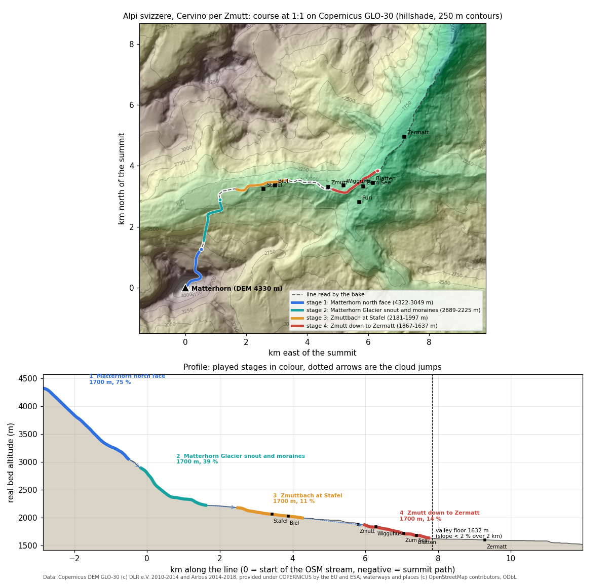

# Swiss Alps: the Matterhorn by Zmutt (`svizzera`)

The drop starts on the top of the Matterhorn. It goes down the north face onto the Matterhorngletscher, follows the glacier's meltwater stream to the Zmuttbach below the Zmutt glacier tongue, and runs past Stafel and the hamlet of Zmutt down to Zermatt. Everything is at real scale, 1:1 in plan and in height.

| | |
|---|---|
| Config | `tools/bake/worlds/svizzera.json` |
| Baked world | `data/worlds/svizzera/` (4 stages, about 2.9 MB) |
| Tests | `test/bake-svizzera.test.mjs` (9 tests), plus the generic checks in `test/bake-worlds.test.mjs` |
| Image | `docs/mountains/svizzera-profile.png`, made by `python3 tools/mountains/render_profile.py svizzera` |
| Vote name | "Swiss Alps, Matterhorn by Zmutt" / "Alpi svizzere, Cervino per Zmutt"; finish "Zermatt" |
| Race | 185 s: two sim bots, 51 + 44 + 43 + 59 s (seed 3), plus 3 cloud jumps of 3.5 s; 183-192 s over seeds 1 to 7, both bots finish every stage |



## The line and why

A drop falling from the top of the Matterhorn can leave by any of its four faces. The north face is the one that sends water to the Zermatt valley by the most direct route:

1. **North face.** It falls about 1,200 m onto the Matterhorngletscher, a mountain glacier of 1.71 km² between 3,632 and 2,693 m (de.wikipedia, older inventory figures); today's OSM outline ends higher, at 2,826 m.
2. **Meltwater stream.** From the snout, an unnamed stream (OSM way 523465039) drops about 600 m in 1.7 km to the Zmuttbach, just below the Zmutt glacier tongue at about 2,240 m.
3. **Zmuttbach.** It runs east past the alp of Stafel and the hamlet of Biel into the Zmutt reservoir (Grande Dixence arch dam, 1964, 74 m high). Below the dam it passes the hamlet of Zmutt at 1,936 m and drops through larch woods to Zermatt.
4. **Zermatt.** The Zmuttbach meets the Gornera at about 1,624 m, and together they become the Matter Vispa.

**Valley floor.** The bake puts it at river km 7.8, 1,632 m, where Zermatt begins. Below that point the mean slope over 2 km is under 2 %: the Matter Vispa falls from about 1,600 m at Zermatt to 1,449 m at Täsch, about 3 % over 6 km, and much of that drop is concentrated in short steps. That is the flat Piave case the spec rules out.

**Alternatives I considered:**

| Option | Why not chosen |
|---|---|
| East face, Furggbach, Gornera | Baked as the `cervino` world (4478 to 1858 m, it ended above Zermatt), archived on 27/10/2026 (config in `tools/bake/worlds/archive/`). `svizzera` keeps the two lines distinct: this one starts on the north face and ends in Zermatt. |
| Zmutt glacier itself (Tiefmatten, Zmuttgletscher) | The water from the summit does not reach it. The Tiefmattengletscher drains the west face and the Dent d'Hérens. The Zmutt tongue is debris covered and gentle, so the summit path would lose 2 km to a nearly flat glacier. |
| Dufourspitze, Gornergletscher | The Gornergletscher is a 12 km valley glacier with a gentle mean slope. The floor rule would end the race on the ice, far from any valley. |
| Eiger north face, Grindelwald | Plausible: a 1,800 m wall above meadows down to Grindelwald (1,034 m). Its OSM streams and DEM were not checked, and it needs a new box. The Matterhorn line already has a real glacier, a real stream and an iconic finish. Kept as a backup if a third Swiss world is wanted. |

**How the bake reads it** (`descent.kind: osm-network`). The walk starts at the head of the meltwater stream (45.9918 N, 7.6646 E) and prefers the Zmuttbach, then the Matter Vispa. Two gaps in the OSM network are bridged: about 250 m near river km 1, and the culvert at the Zmutt dam.

The summit path is a least-cost downhill line through one point on the Matterhorngletscher (45.9862 N, 7.6612 E). It is smoothed with `pathSigma` 130 m. With the default 60 m it zigzagged, one bot kept freezing and respawning on the zigzag, and a full stage took 182 s. Even at 130 m it does not run straight down the face: between about 4,200 and 3,800 m it traverses east-north-east towards the Hörnli ridge side of the north face, then back north-west, on average 26° off the DEM fall line (30 of 165 points more than 45° off). The real fall line from the top runs almost due north (about 7.657 to 7.660 E) onto the glacier, but on GLO-30 it is a 150 % slope for 600 m, and with via points on it both bots respawn about 15 times and never finish stage 1. The least-cost cost function keeps the path near a 55 % slope on purpose, so the diagonal is the playable compromise, not a data error.

The OSM answers in `data/raw/osm/svizzera/` are byte copies of the `cervino` cache. The two worlds use the same boxes, so the Overpass queries are identical and no new download was needed.

## Stages

| # | Stage (it / en) | River km | Real bed | Length | Mean slope | Zones, branches | Animals |
|---|---|---|---|---|---|---|---|
| 1 | Parete nord del Cervino / Matterhorn north face | -2.86 to -0.50 (summit path) | 4322 to 3049 m | 1700 m | 75 % | ice (ends on the Matterhorngletscher) | lammergeier, alpine chough x2 |
| 2 | Fronte e morene del ghiacciaio del Cervino / Matterhorn Glacier snout and moraines | -0.16 to 1.61 | 2889 to 2225 m | 1700 m | 39 % | ice named Matterhorngletscher on the first 110 m only, then the forefield (biome `moraine`); safe arm | chamois, marmot, lammergeier, Hérens cow |
| 3 | Zmuttbach a Stafel / Zmuttbach at Stafel | 2.48 to 4.27 | 2181 to 1997 m | 1700 m | 11 % | sun; Stafel and Biel on the stage | chamois, marmot, lammergeier, ptarmigan, ibex |
| 4 | Da Zmutt a Zermatt / Zmutt down to Zermatt | 5.97 to 7.75 | 1867 to 1637 m | 1700 m | 14 % | rain, 14 rocks; Wigguhüs, Furi, Zum See, Blatten | lammergeier, Hérens cow, ibex, marmot, chough |

| | |
|---|---|
| Played | 6.8 km of 10.7 km of steep line |
| Drop | 2,685 m |
| Cloud jumps | 3 |
| Skipped by the cloud | the snout of the meltwater stream; the Zmutt reservoir (flat) and its dam (km 4.3 to 6.0, Zmutt itself at km 5.8) |
| Shortcut branch | none (`requireShortcut: false`). The bends are too tight for one at this smoothing; the bake's reason is "too close" |

**Published values against the bake** (checked in `test/bake-svizzera.test.mjs`):

| Point | Published | Bake | Note |
|---|---|---|---|
| Matterhorn summit | 4477.5 m (swisstopo, shown as 4478) | DEM top 4330 m, race start 4322 m | GLO-30 is 120 to 275 m too low within 100 m of the summit, so its top lands 150 m west of it, on ground that swissALTI3D puts at 4318 m: the race starts about 160 m below the real summit. The vote shows 4478 |
| Matterhorngletscher, lowest point | 2,693 m (de.wikipedia, older inventory) | OSM outline lowest at 2826 m on GLO-30 (45.9920 N, 7.6626 E); stage 2 starts on it at 2889 m and leaves the ice after 110 m | |
| Zmutt glacier tongue / Zmuttbach source | about 2,250 m | line at 2220 m (river km 1.75) | |
| Zmutt hamlet | 1,936 m | between stages 3 (ends 1997 m) and 4 (starts 1867 m) | |
| Zmuttbach / Gornera confluence | 1,623 m (swissALTI3D at the OSM junction) | finish 1637 m, 98 m from it (swissALTI3D 1630 m there) | |
| Zermatt | 1,608 m (OSM `ele`) | valley floor 1632 m, finish within 1.8 km of the centre | |

**Review of 27/10** (independent pass on the same data):
- The bed follows the DEM: sampled at every course point, the carved bed sits on average 1 to 7 m under the GLO-30 surface (at most 18 m on the north face). The DEM top near the Swiss summit is 4329 m, about 150 m west of it.
- Stage 2 was named "Matterhorn Glacier" with the glacier palette, but only its first 11 of 171 points lie inside the OSM outline of the Matterhorngletscher. The rest is the meltwater stream through the glacier forefield. It is now "Matterhorn Glacier snout and moraines" with the `moraine` biome (same stage id, same stretch, same timing).
- The ibex band went from 3300 to 3000 m, so no ground animal stands on glacier ice (`test/bake-svizzera.test.mjs` checks every spawn against the OSM outlines).
- The finish is 98 m from the OSM junction of the Zmuttbach and the Gornera (46.0112 N, 7.7393 E). The Zmutt dam facts match Grande Dixence and swissdams.ch: arch dam, 74 m, built 1961 to 1964.
- Every model licence in the table below was checked on 27/10: on the Sketchfab API (licence, face count, author) and on the Poly Pizza pages.

**Second review of 27/10: the bed against swissALTI3D.** The swisstopo height service (`api3.geo.admin.ch/rest/services/height`, swissALTI3D, LV95) was read at every 10th course point and at the reference places. `test/bake-svizzera.test.mjs` keeps a subset of these spot heights.

| Stretch | Bake bed minus swissALTI3D | Reading |
|---|---|---|
| Stage 1 above about 3,750 m (points 10-60) | -30 to -84 m | GLO-30 is too low around the summit (120 to 275 m within 100 m of it) |
| Stage 1 from 3,750 to 3,400 m | +3 to +44 m | steep face, 30 m cells |
| Stage 1 on the glacier, stages 2 and 3 | -6 to +8 m (one +24 m step in stage 2) | good |
| Stage 4, the Zmutt gorge, its first 1,000 m | +21 to +50 m | GLO-30 is a surface model with 30 m cells: it fills the narrow gorge and its larch wood, so the played bed runs 40-50 m above the real gorge floor. On swissALTI3D the stage falls from 1,828 to 1,630 m (11.6 %), not from 1,867 to 1,637 m |
| Finish | +7 m | 1,630 m real, 1,623 m at the confluence |

The reference places agree with swissALTI3D: Zmutt 1,935 m (published 1,936), Stafel 2,138 m (OSM 2,139), the OSM Zermatt node 1,604 m (published 1,608). The fix for the summit and the gorge is the one the spec already names: swissALTI3D for Switzerland (free swisstopo open data, 2 m). That needs a reader in `tools/bake/dem.mjs`, which every world shares, so it is left as an open issue and not patched here.

Other points of the second review:
- The ice zone of stage 1 covers the whole stage and carries `glacier: "Matterhorngletscher"`, but only points 89-170 (from about 3,520 m down) lie inside the OSM outline. Points 0-88 are ice because they are above `iceAbove` (3,300 m), and the bake merges the two runs into one zone named after the glacier. Ice on the upper north face is right; the glacier name on that part is not. This comes from how the bake merges zones, not from a config value.
- The bearded vulture pair settled in the Zermatt area around 2012 and raised its first young in 2016 (1815.ch).
- Every Sketchfab and Poly Pizza licence in the table below was checked again on 27/10 and matches (the ptarmigan scan is still CC-BY-ND).
- The vote name "Cervino per Zmutt" can be read as the Zmutt ridge (Zmuttgrat), the classic north-west climbing route. The line takes the north face and the Zmutt valley instead.

## Fauna by altitude band

These bands are the ones in `animals.kinds` of the config. The bake spawns a species only where the real bed altitude lies inside its band. Species keys are the renderer's (`src/render/animals/species.js`): `herens`, `chough`, `ibex`, `chamois`, `marmot`, `lammergeier` (soaring, `flying` in the bake), `ptarmigan`.

| Species (key) | Band | What the sources say | Sources |
|---|---|---|---|
| Alpine ibex (`ibex`) | 1600-3000 m | 1,800-3,300 m in general; 1,600-3,000 m around Zermatt, the band used here: with 3,300 m the bake put an ibex on the Matterhorngletscher ice at 3,209 m; salt licks on the Gornergrat in summer. IUCN Least Concern; over 17,800 animals in Switzerland | [Wikipedia](https://en.wikipedia.org/wiki/Alpine_ibex), [Zermatt Tourismus](https://www.zermatt.ch/en/randa/FloraFauna-Wildbeobachtung/game-watching-in-zermatt-a-unique-experience), [Gornergrat Bahn](https://www.gornergrat.ch/en/stories/geschichte-most-beautiful-ibexes) |
| Chamois (`chamois`) | 1200-3000 m, at most 3 per stage | Lives in alpine grassland and in steep rocky forest lower down; up to 50 can be seen on the Schafberg above Zermatt in winter | [Zermatt Tourismus](https://www.zermatt.ch/en/randa/FloraFauna-Wildbeobachtung/game-watching-in-zermatt-a-unique-experience), [Kanton Aargau, Gämse](https://www.ag.ch/de/themen/landwirtschaft-tiere/wild-wassertiere/jagd/massnahmenplaene/gaemsen) |
| Alpine marmot (`marmot`) | 1600-2800 m | 1,200-3,000 m in the southern Alps; about 1,000 animals around Zermatt, on the Riffelberg and Riffelalp | [Gornergrat Bahn](https://www.gornergrat.ch/en/stories/geschichte-marmots-on-the-gornergrat), [Swiss National Park, marmots (PDF)](https://nationalpark.ch/wp-content/uploads/2023/10/Murmeltiere_Fredy_Frey.pdf), [DAV](https://www.alpenverein.de/artikel/das-murmeltier_f9a8c3e1-564a-4ef5-b3f7-f1e515cfe005) |
| Bearded vulture (`lammergeier`) | 1500-4500 m, flying, at most 1 | A breeding pair has lived in the Zermatt area since about 2012; five pairs in Valais; 26 broods in Switzerland in 2024 | [Zermatt Tourismus, book on the Zermatt pair](https://www.zermatt.ch/en/Media/News/Buch-ueber-Zermatter-Bartgeierpaar), [1815.ch](https://new.1815.ch/news/wallis/aktuell/bartgeierpaar-in-zermatt-zieht-erfolgreich-einen-jungvogel-auf), [Stiftung Pro Bartgeier, annual report](https://beardedvulture.ch/sites/default/files/dokumente/Jahresberichte/JahresberichtSPB2023_2024_LR.pdf) |
| Rock ptarmigan (`ptarmigan`) | 1900-3000 m, at most 2 | Alpine heath and boulder fields, mainly 1,800-2,400 m in the eastern Alps, higher in Valais; grey-brown above with white wings in summer, white in winter. IUCN Least Concern | [Wikipedia](https://en.wikipedia.org/wiki/Rock_ptarmigan), [NABU](https://www.nabu.de/tiere-und-pflanzen/voegel/portraets/alpenschneehuhn/), [LfU Bayern (PDF)](https://www.lfu.bayern.de/natur/natura_2000/vogelschutzrichtlinie/doc/raufusshuehner.pdf) |
| Alpine chough (`chough`), not in the spec list | 1600-4500 m, at most 2 | Breeds at 1,260-2,880 m in Europe and follows climbers far higher (8,200 m on Everest). It is the bird of the Hörnli hut and the summit ridge. Added so the 3,000-4,300 m stage is not empty; the model already exists | [Wikipedia](https://en.wikipedia.org/wiki/Alpine_chough) |
| Hérens cow (`herens`) | 1600-2300 m, ground under 30 % slope | The cows of the summer alps of Stafel and Zmutt: the Stafel alpine dairy makes the cheese of the cows grazing round it, and the Zermatt herds are of the Valais breed, the black-brown Hérens (Eringer) fighting cow, not the Brown Swiss of the spec draft (changed 28/10; the game draws it from the alpine cow model, shorter in the leg, near black, short horns) | [Zermatt, Stafel alpine dairy](https://zermatt.swiss/en/p/alpine-dairy-stafel-01tVj000005DnhfIAC), [Julen family, the Zermatt Eringer herd](https://www.julen.ch/en/tradition-julen/the-cows/), [Zmutt hamlet](https://zermatt.swiss/en/p/hamlet-of-zmutt-01tVj000005DpjNIAS) |

The vogelwarte.ch species pages (Alpenschneehuhn, Alpendohle) did not render through the fetcher on 27/10. The Swiss breeding-bird atlas remains the source to cite once someone opens them in a browser.

## Free 3D model candidates

The rules come from the spec: free models only (CC0 or CC-BY), the same body plan if the species itself is missing, reshaped and repainted at load time in `src/render/animals/species.js`, and never primitives. Nothing was downloaded for this doc. "In game" means the model is already in `assets/vendor/animals/` for the Dolomiti.

| Species | Candidate | Licence | Notes |
|---|---|---|---|
| Ibex | [Goat (horned), Poly by Google](https://poly.pizza/m/bSetPnvQB5G) | CC-BY 3.0 | in game as `ibex` |
| | [Ibex, Syl](https://poly.pizza/m/a6kS-lGDqV4) | CC-BY 3.0 | low poly, faceted: smooth with the existing subdivide pass |
| | [Ibex, Lary (Sketchfab)](https://sketchfab.com/3d-models/ibex-f7c4914e04404e1e85f1e5215131ad0a) | CC-BY | 1,111 faces, low poly |
| | [Alpine ibex, iRahulRajput (Sketchfab)](https://sketchfab.com/models/ae0234e8def04ddd807040e6618d105f) | CC-BY | 545,601 faces, realistic: decimate first |
| Chamois | [Goat, Poly by Google](https://poly.pizza/m/d7dImmjtF8E) | CC-BY 3.0 | in game as `chamois` |
| | [Chamois, Rainbow Yoshi Gun (Sketchfab)](https://sketchfab.com/3d-models/chamois-3c4eb978b2ed4bd494b265caf0f44e9c) | CC-BY | 18,084 faces, the species itself, no description: check the shape |
| | [Chamois, Museo [UV] Historia Natural (Sketchfab)](https://sketchfab.com/models/8c279797eed148ddac38f6e78b73e27f) | CC-BY | museum scan, 3.3 M faces: decimate |
| Marmot | [Gopher, Poly by Google](https://poly.pizza/m/2IatILCJa3X) | CC-BY 3.0 | in game as `marmot` |
| | [Marmot rig, quentin.cdt (Sketchfab)](https://sketchfab.com/3d-models/marmot-rig-bf70e9fdea114943b0dc5cff336bf3e0) | CC-BY | 13,988 faces, rigged, the real species: best upgrade |
| | [marmot textured, szibartas (Sketchfab)](https://sketchfab.com/models/d1a34209aecc492880b2405ddb6b27c6) | CC-BY | 50,284 faces |
| Bearded vulture | [Bearded Vulture, rhuvenciyo (Sketchfab)](https://sketchfab.com/3d-models/bearded-vulture-6575ea494832489abeb551a0e2826cd6) | CC-BY | 37,470 faces, ZBrush sculpt, the only model of the species; check pose and provenance (the description links to another site) |
| | [Turkey vulture, Poly by Google](https://poly.pizza/m/fvAgunyr1kd) | CC-BY 3.0 | in flight, same body plan; repaint rusty underparts, black mask and beard, wedge tail |
| | [Bird (soaring), Poly by Google](https://poly.pizza/m/8Ph79kHbt9s) | CC-BY 3.0 | in game as `eagle`; longer, narrower wings and a wedge tail make it a lammergeier |
| | [Black Vulture, Innovation Studio (Sketchfab)](https://sketchfab.com/3d-models/black-vulture-e08e8ccef02f4c99948c8f4a3132c8fa) | CC-BY | museum mount, perched, 50,668 faces |
| Rock ptarmigan | **no free model of the species can be used** | | the only one, [White-tailed ptarmigan (RMAP)](https://sketchfab.com/models/e7bb7120fc1640999907497a66e82e8a), is CC-BY-ND, and a no-derivatives licence forbids the repaint |
| | [Ruffed Grouse, Innovation Studio (Sketchfab)](https://sketchfab.com/3d-models/ruffed-grouse-e0f2d244cdd74403a9a1796eb9951981) | CC-BY | same grouse subfamily, smooth museum mount, 24,508 faces: best base (shorter tail, feathered feet, white wings) |
| | [Quail, Poly by Google](https://poly.pizza/m/4A0kLzM65Mg) | CC-BY 3.0 | low poly galliform, small and round |
| | [Western capercaillie (Sketchfab)](https://sketchfab.com/3d-models/western-capercaillie-87aeee7a22e2477c9ee5897c138a4156) | CC0 | scan, 345,540 faces, much bigger bird: decimate and slim |
| | [Chicken, Quaternius](https://poly.pizza/m/ineV9pU5VL) | CC0 | stylised; the comb and tail need heavy edits |
| | Grouse, TheNorthernHarpy (Sketchfab) | CC-BY | rejected: 192 faces, Blockbench/Minecraft style, boxy |
| Alpine chough | **no model of the species** (Sketchfab has only skeleton scans) | | |
| | [Raven, Poly by Google](https://poly.pizza/m/5oae0lwh9fF) | CC-BY 3.0 | in game as `chough`: yellow bill, red legs |
| | [Crow, Poly by Google](https://poly.pizza/m/1MIvWQ5Q3R9) | CC-BY 3.0 | alternative body |
| Cow (Brown Swiss) | [Cow, Quaternius](https://poly.pizza/m/26zM1outCr) | CC0 | in game as `cow`, painted as a brown alpine cow |
| | [Cow, Quaternius](https://poly.pizza/m/5XSc2Fka3F) and [Bull, Quaternius](https://poly.pizza/m/a8PIIYwF7r) | CC0 | same family, static |
| | [Farm Cow Animated, Rukh3D (Sketchfab)](https://sketchfab.com/3d-models/farm-cow-animated-dairy-cattle-0e780cb5ab6d457198ded7d4e191a03e) | CC-BY | 9,546 faces, 5 animations (idle, run, jump) |

**Not used: Kenney.** Its 3D animals are the "Cube Pets" set (cubic, the boxy look the spec rejects), and "Animal Pack Redux" is 2D. **Quaternius** has cows, a bull and a chicken, but no goat, vulture or grouse.

**Species with no smooth, non-boxy model of their own:**
- **Rock ptarmigan:** derive it from the Ruffed Grouse or the Quail.
- **Alpine chough:** derive it from the Raven (already done for the Dolomiti).
- **Bearded vulture:** the Sketchfab sculpt still has to be checked, otherwise derive it from the Turkey vulture or the soaring Bird.

## Rebake

```
node tools/bake/index.mjs svizzera --offline          # 3 s, also refreshes data/worlds/index.json
node --test test/bake-svizzera.test.mjs               # about 8 s, two fresh bakes included
python3 tools/mountains/render_profile.py svizzera    # this page's image (node + matplotlib)
```

Credits: elevation from the Copernicus DEM GLO-30, (c) DLR e.V. 2010-2014 and (c) Airbus Defence and Space GmbH 2014-2018, provided under COPERNICUS by the European Union and ESA. Waterways, glacier outlines and places (c) OpenStreetMap contributors, ODbL.

## The look, element by element

The renderer's theme is `src/render/themes/svizzera.js`, checked in `test/render-svizzera.test.mjs`. It shows late October, the season of the two paintings in `assets/backdrops/` and of their source photos (CREDITS.md there): fresh snow on the high ground, the larches gone gold. Renders: `docs/screens/world-svizzera-s0.png` to `s3.png`, `world-svizzera-hero.png` (Stafel stage) and `world-svizzera-summit.png` (the Matterhorn from Stafel). Every visible element and what it rests on:

| Element | Where | In the game | Source |
|---|---|---|---|
| Rock of the face | stage 1, the high ground everywhere, the cliffs of the Zmutt gorge | dark grey-violet gneiss in ragged outcrops on all steep ground (from 42 deg low down, from about 20 deg high up: the whole north face), no carved Dolomite terraces (`massif` off) | The Matterhorn is Arolla gneiss of the Dent Blanche nappe over the ophiolites (serpentinite, greenstone) of the Zermatt-Saas zone: [Dent Blanche nappe](https://en.wikipedia.org/wiki/Dent_Blanche_nappe), [Zermatt-Saas zone](https://en.wikipedia.org/wiki/Zermatt-Saas_zone), [Leeds, the Matterhorn](https://www.see.leeds.ac.uk/structure/internalalps/matterhorn.htm) |
| Snow | above about 3000 m on ground under about 38 deg, 150 m higher on south-facing slopes | crisp white patches on the ledges and the ice fields, dark rock between them on the face | October snow line of the source photos; north-facing ground holds snow lower (the sunny side, below) |
| Glacier ice | gentle ground above 2850 m | bare blue-white ice with blue streaks | Matterhorngletscher, 3632 to 2693 m (older inventory), OSM outline to 2826 m (see "The line" above) |
| Moraine rubble | 2180-2900 m, on the shaded side and the valley floor | debris grey with the painting's violet, in broken patches | The glacier forefield of stage 2, grey in the summit photo (File:ZmuttValley.jpg) |
| Sunny side | everywhere (`terrain.sunnySide`) | south-facing slopes keep their pasture about 150 m higher (north-facing ones turn bare 150 m lower), carry no forefield rubble | The Höhbalmen pasture at 2665 m, above the timberline on the south-facing side of the Zmutt valley: [Zermatt, Edelweiss Trail Höhbalmen](https://light.zermatt.ch/en/Media/Planning-hikes-tours/Edelweiss-Trail-Hoehbalmen-Nr.-30), [hikingwalking.com, Hohbalm](https://hikingwalking.com/index.php/destinations/sw/sw_valais/zermatt/hohbalm/hohbalm_detail) |
| Bare ground | above 2600 m (2750 m facing south, 2450 m facing north) | no grass: grey scree, rubble and rock up to the snow | as above; both source photos show no grass above the forefields |
| Pasture | below about 2600 m | dry straw-gold grass, olive where still green, broken by grey scree runs (1900-2700 m) and darker olive grass in the gorge | The golden slopes of the Zmutt valley photo (File:Zmutttal (22386927726).jpg, October) |
| Larch (Larix decidua) | 1500-2250 m, about half of the trees | the open larch shape (narrow, few thin tiers, the trunk showing between them), orange-gold in late October | Zermatt has the highest closed forest of the Alps, over 2300 m, larch and arolla pine ([Zermatt, highest trees](https://light.zermatt.ch/en/Media/Magazinbeitraege/Highest-trees-in-Switzerland)); larches turn yellow-orange in late October ([swissfamilyfun, golden larches](https://swissfamilyfun.com/golden-larches/)) |
| Arolla pine (Pinus cembra) | 1700-2250 m | the stone pine shape: a dense, dark blue-green crown of rounded lumps | same Zermatt source |
| Spruce (Picea abies) | below about 1850 m | the tiered spruce cone, dark green | same Zermatt source (spruce below 2200 m); open woods, not a closed wall (`trees.cover` by altitude, `trees.wall` 20) |
| Open forefield at Stafel | stage 3 | scattered larches and stone pines, about half the density of the woods (`stages.stafel.trees`) | the valley floor round Stafel in File:Zmutttal (22386927726).jpg and File:ZmuttValley.jpg: open ground, trees in loose groups |
| Juniper, alpenrose | 1700-2600 m | low dark green scrub in patches | the dwarf-shrub belt above the Valais treeline |
| No trees | above about 2300 m: stages 1 and 2 above Stafel | none on the face, the ice or the forefield | treeline as above |
| Water | every stage | opaque milky grey-turquoise glacial water, soft facets, foam streaks along the flow, grey silt and gravel banks (no red earth) | The Zmuttbach and the meltwater stream come off the Matterhorn and Zmutt glaciers; milky pools in the summit photo |
| Boulders | stage 4 and the banks | grey gneiss | as the rock |
| Far peaks, stages 1 and 2 | looking north-north-east from the face and the forefield | the real 3D terrain (GLO-30): Wellenkuppe, Ober Gabelhorn, Mettelhorn ridge, no painting | The view painting is of the Zmutt valley looking east, so it would put the wrong mountains there; the baked terrain reaches 10 km north |
| View painting, stages 3 and 4 | ahead, downhill to the east | the Zmutt valley towards Zermatt and the Mischabel-Allalin range | File:Zmutttal (22386927726).jpg (CREDITS.md) |
| Summit painting, stages 3 and 4 | behind, looking back up | the Matterhorn north face over the Zmutt glacier, turned to its real bearing: 216 deg from Stafel, 239 deg from Zmutt | File:ZmuttValley.jpg; bearings from the baked frame (test) |
| Light | all stages | golden hour, sun low behind the left shoulder of the downhill view, thin dry haze | the painting's light |
| Animals | as baked (fauna table above) | ibex, chamois, marmot, lammergeier, alpine chough, rock ptarmigan, Hérens cow | fauna table above; spawn altitudes 4063 to 1681 m all inside their bands |

**Known gaps.** The 3D Matterhorn itself is the GLO-30 surface, up to 275 m too low at the top and rounded, so from Stafel and Zmutt it dissolves into the summit painting from 1.8 and 3.5 km (per-stage `cut`). The upper left of the view painting is the photographer's own golden slope, so on bends of stage 4 it shows as a tall golden wall cut by the painting's top edge. No huts or hamlets are drawn (Stafel, Zmutt, Furi, Zum See are on the course: the renderer has no buildings). One ptarmigan spawns at 2046 m near Stafel, inside the baked band but low for the species in October.
